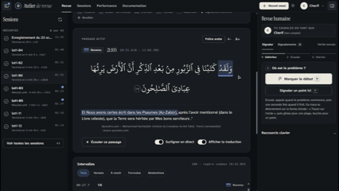

<div align="center">

# artist-quran-recognizer

**Listens to an audio or video file, finds every Quran verse that is recited and from which second to which second, then shows the exact Mushaf text with its translation. Everything else is ignored.**

[Version française](README.md) · [Contributing](CONTRIBUTING.md) · [Roadmap](#roadmap)



<sub>The web workshop while listening: the spoken word and its matching translation fragment light up live. The Arabic text comes from the corpus, never from a model.</sub>

</div>

---

> **Project status.** The engine works end to end on files, with a web review workshop. **Live detection** on a stream is the goal, not yet a reality. No fine-tuning has been done.
> **No human-validated ground truth exists yet**: the figures in this repository mean "named", not "correct". [Help us validate by ear](https://github.com/Maximus203/artist-quran-recognizer/issues/87).
> Most of the in-depth documentation is in French; this page and [CONTRIBUTING.md](CONTRIBUTING.md) are the English entry points. Issues and PRs in English are welcome.

## Why

A recitation, a filmed prayer, a lesson quoting verses between commentary in French or Wolof: finding *which* verse is said, *when*, and subtitling it properly is long manual work. Existing tools are closed, or require you to declare in advance what will be recited.

`artist-quran-recognizer` answers one question: **which Quran verses are recited, from which second to which second?** For each one it returns the **exact Mushaf text** (from the corpus, not from a model) and the **official translation** (QuranEnc, unmodified), with a **proof status** (recognized, inferred or uncertain).

Guiding principle: **naming a wrong verse is worse than naming none.** When in doubt, the system abstains. No generative language model is in the Quranic chain ([ADR-0001](docs/adr/0001-pas-de-llm-generatif.md)).

## The web workshop

[`web/`](web) is a local Next.js workshop to import audio and video, see what the engine understood, and **flag what is wrong**. Flags carry their exact range and become test cases for the engine and, later, ground truth.

<table>
<tr>
<td width="50%"></td>
<td width="50%"></td>
</tr>
</table>

- Import several audio/video files at once, or record from the microphone; analyses go through a **queue**.
- **Exact listening**: the player plays a copy decoded the same way as the engine (variable-bitrate MP3s otherwise drift by seconds in browsers).
- **Live highlighting** of the recited word and the matching translation fragment, repetitions included.
- Built for **long files** (waveform computed server-side, drag to pan, zoom windows).
- **Human review**: draw the faulty range on the waveform, preset chips, keyboard shortcuts, exportable ZIP pack.
- **Accounts** (hashed passwords, first account = admin), global or private sessions, server-side preferences, quotas.

Meant for **local use**. Everything works offline once the models are downloaded; no audio is sent anywhere.

## How the engine works

```
  audio or video file
        │
  1. EXTRACT     ffmpeg → mono 16 kHz
  2. SEGMENT     into speech chunks (recitation segmenter)
  3. LISTEN      an ASR model (FastConformer) transcribes each chunk; Whisper and a streaming
                 model re-listen ONLY to doubtful chunks                              (ADR-0009)
  4. SEARCH      transcript matched against the Quran text, tolerant to ASR errors  (ADR-0003/4)
  5. CONFIRM     chain proof: short consecutive verses confirm each other            (ADR-0007)
                 acoustic proof: the CORPUS text is force-aligned on the audio;
                 if the sound does not support it, nothing is named               (ADR-0006/8)
  6. FILL        gaps between recognized verses, missing starts/ends, completed
                 from what the audio really contains                               (ADR-0010/13)
  7. DECIDE      recognized / inferred / uncertain / abstention
  8. RENDER      corpus Arabic + QuranEnc translation + timings (start, end, per word)
        │
  JSON `aqr.recognition/1` (+ SRT / VTT)  →  web workshop
```

The ASR model only *locates*. It may mishear, so it never writes the final text: the system searches the corpus for what resembles what was heard, then **checks on the audio** that the corpus text matches. If proof is missing, it abstains. Details: [docs/SYSTEME-EN-BREF.md](docs/SYSTEME-EN-BREF.md) (French), [architecture](docs/ARCHITECTURE.md), [ADRs](docs/adr).

### Invariants (non-negotiable)

| # | Rule |
|---|---|
| I1 | Displayed Arabic text **always comes from the corpus**, never from a model. |
| I2 | Translations are QuranEnc's, **unmodified**, with id, version and attribution. |
| I3 | **A wrong verse is worse than none.** Precision beats recall. |
| I4 | Non-Quranic speech must produce **no verse**. |
| I5 | Every detection carries a **proof status**. |
| I6 | The **riwaya** is a parameter (only Hafs is handled today). |
| I7 | Every brick is **replaceable** behind a tested interface. |

### What is measured, and its limits

On EveryAyah (216 verses) the share of recognized verses went 71.8 % → 91.2 % → 96.8 % → **97.7 %** as decision bricks were added, with **0 false verse**; the models are unchanged. These are **not accuracy rates**: there is no human ground truth on real audio, and EveryAyah is an optimistic ceiling. Read [the limits](docs/SYSTEME-EN-BREF.md#ce-que-ces-chiffres-ne-disent-pas) before quoting a number.

## Quick start

Requirements: Python ≥ 3.11, [ffmpeg](https://ffmpeg.org), an NVIDIA GPU recommended (CPU works, slowly), Node 24 for the web workshop.

```bash
git clone https://github.com/Maximus203/artist-quran-recognizer.git
cd artist-quran-recognizer
python -m venv .venv && . .venv/bin/activate      # Windows: .venv\Scripts\activate
pip install -e ".[dev]"
python scripts/fetch_corpus.py                    # Quran text (Tanzil), checksum-verified
pytest

pip install -e ".[asr,data]" && pip install --no-deps -e ".[segmenter]"
python scripts/fetch_models.py                    # pinned models → $AQR_MODELS_DIR (outside Git)
aqr recognize lesson.mp3 --out-dir out            # → out/lesson.recognition.json (+ .srt, .vtt)
```

Web workshop:

```bash
cd web && npm ci
export AQR_PYTHON="$(pwd)/../.venv/bin/python" AQR_MODELS_DIR=/path/to/models \
       AQR_CORPUS_DIR="$(pwd)/../data/corpus" AQR_REVIEW_DIR=/path/to/review-data
npm run build && npm run start -- -p 3100
```

Open `http://127.0.0.1:3100`, create an account (the first one is admin) and drop an audio file. All `AQR_*` variables: [web/README.md](web/README.md) (French). Only import audio you have the rights to; **no audio file or model is versioned** in this repository.

## Roadmap

| Topic | Status | Tracking |
|---|---|---|
| **Live detection** over WebSocket, **no declared range** | Design ([ADR-0011](docs/adr/0011-detection-en-direct-sans-plage.md)) and measurements; no streaming code yet | [#84](https://github.com/Maximus203/artist-quran-recognizer/issues/84) |
| **Subtitle export** (SRT, VTT, ASS) with an ambiguity check | Being designed | [#86](https://github.com/Maximus203/artist-quran-recognizer/issues/86) |
| **Human ground truth** (2–3 h of real audio validated by ear) | Tooling ready, **reviewers wanted** | [#87](https://github.com/Maximus203/artist-quran-recognizer/issues/87) |
| **Fine-tuning** | Not done; conditions and data | [#88](https://github.com/Maximus203/artist-quran-recognizer/issues/88) |
| **Non-Quranic parts**: transcribe and translate Wolof/English/colloquial Arabic to French | Idea tracked, not the current goal | [#85](https://github.com/Maximus203/artist-quran-recognizer/issues/85) |

Beginner-friendly tasks: [`good first issue`](https://github.com/Maximus203/artist-quran-recognizer/labels/good%20first%20issue).

## Contributing

There is work at every level: listening and validating (no code), accessibility testing, Windows portability, new translations, measurements, the streaming engine. See [CONTRIBUTING.md](CONTRIBUTING.md). In short: one PR per brick into `develop`, test first, invariants I1–I7 are not negotiable, and never put secrets, audio, recordings of people or model weights in Git.

```bash
pytest && ruff check src tests scripts && ruff format --check src tests scripts && mypy
```

## License, attributions and limits

- **Code license: [MIT](LICENSE)** for now. The maintainer has decided the project will be **non-commercial** and released under a non-commercial license; that switch is **not done yet**. Meanwhile, do not assume commercial rights over the models and datasets involved (some are non-commercial): see [CREDITS.md](CREDITS.md).
- **Quran text**: [Tanzil Project](https://tanzil.net) (CC-BY-3.0), downloaded on demand, unmodified, not redistributed here.
- **Translations**: [QuranEnc.com](https://quranenc.com), unmodified, with source and version.
- **Models** and **fonts**: see [CREDITS.md](CREDITS.md). The KFGQPC Hafs font is **not** redistributed.
- Hafs only. This software is an aid, not an authority: **reading and verifying the Quran remain human.**
