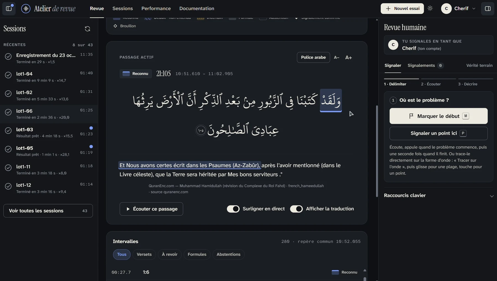
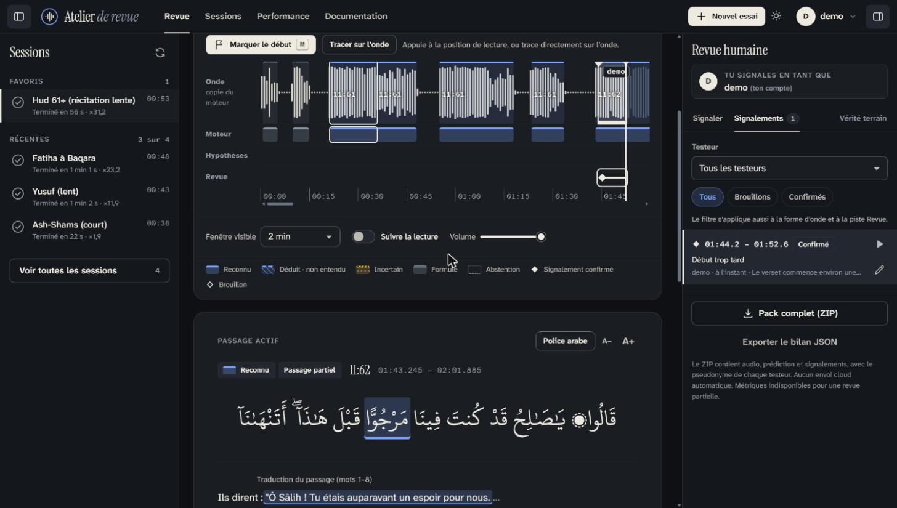
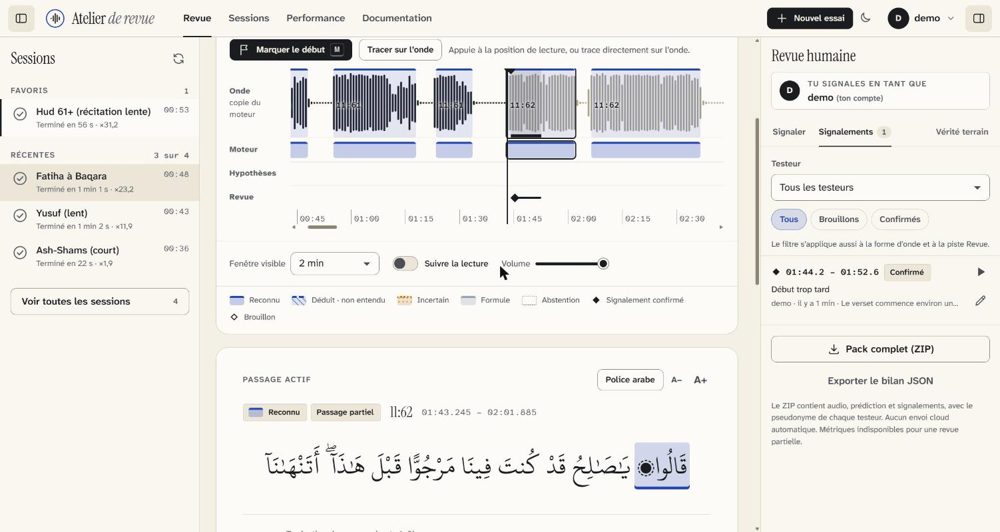
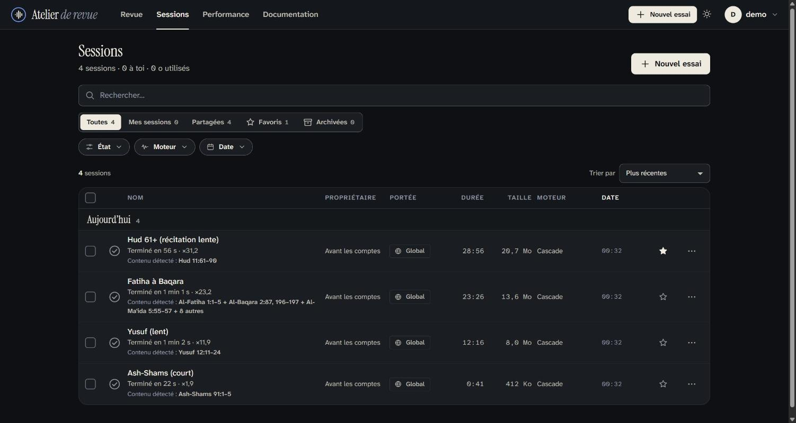
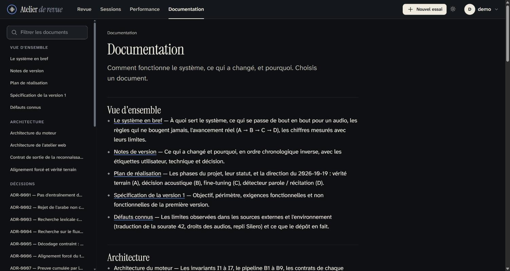

<div align="center">

# artist-quran-recognizer

**Dépose un audio ou une vidéo : l'atelier retrouve chaque verset du Coran récité, l'affiche au bon moment avec sa traduction, et te laisse corriger ce qui est faux.**

[English](README.en.md) · [Démarrage](#démarrage) · [Contribuer](#contribuer) · [Détails techniques](#détails-techniques)



<sub>[Voir la démonstration en MP4](docs/assets/demo-atelier.mp4) (sans le son)</sub>

</div>

---

## L'atelier

Une application web **locale** : tu importes un enregistrement, tu l'écoutes, et tu vois en direct quel verset est récité.

- **Le mot récité s'allume**, avec le fragment de traduction qui lui correspond. Le texte arabe vient toujours du Mushaf, jamais d'un modèle.
- **Tout ce qui n'est pas du Coran est ignoré** (cours, hadiths, invocations, autres langues).
- **Tu corriges à l'oreille** : tu traces la plage fautive sur la forme d'onde, tu choisis une puce (« verset faux », « début trop tard »…), tu valides. Tes corrections servent de cas de test au moteur.
- **Plusieurs fichiers d'un coup**, ou un enregistrement au micro, avec une file d'analyse et une estimation du temps restant.
- **Fait pour les longs audios**, thèmes clair et sombre, mobile, comptes et sessions privées ou partagées.

<table>
<tr>
<td width="50%"></td>
<td width="50%"></td>
</tr>
<tr>
<td width="50%"></td>
<td width="50%"></td>
</tr>
</table>

> **Projet en développement.** Les résultats sont à vérifier à l'oreille : aucune vérité terrain validée par un humain n'existe encore. [Aide-nous à en construire une](https://github.com/Maximus203/artist-quran-recognizer/issues/87).

## Démarrage

Il faut Python 3.11+, Node 24, [ffmpeg](https://ffmpeg.org) et, de préférence, un GPU NVIDIA.

```bash
git clone https://github.com/Maximus203/artist-quran-recognizer.git
cd artist-quran-recognizer
python -m venv .venv && . .venv/bin/activate         # Windows : .venv\Scripts\activate
pip install -e ".[dev,asr,data]" && pip install --no-deps -e ".[segmenter]"
python scripts/fetch_corpus.py && python scripts/fetch_models.py

cd web && npm ci && npm run build
export AQR_PYTHON="$(pwd)/../.venv/bin/python" AQR_MODELS_DIR=/chemin/modeles \
       AQR_CORPUS_DIR="$(pwd)/../data/corpus" AQR_REVIEW_DIR=/chemin/donnees
npm run start -- -p 3100
```

Ouvre `http://127.0.0.1:3100`, crée un compte (le premier est administrateur) et dépose un audio. Réglages et sécurité : [web/README.md](web/README.md).

> N'importe que des audios dont tu as les droits. Aucun audio ni modèle n'est jamais versionné dans ce dépôt.

## Contribuer

Il y a du travail pour tous : **écouter et valider des passages (aucun code)**, tester l'accessibilité, porter les scripts sous Windows, améliorer le moteur. Commence par [CONTRIBUTING.md](CONTRIBUTING.md) et les tickets [`good first issue`](https://github.com/Maximus203/artist-quran-recognizer/labels/good%20first%20issue).

## Licence

Code sous [MIT](LICENSE) pour l'instant. Le mainteneur prévoit un usage non commercial ; certains modèles le sont déjà. Détail et attributions : [CREDITS.md](CREDITS.md).

---

## Détails techniques

Pour qui veut comprendre ou améliorer le moteur. Tout ce qui suit est facultatif pour utiliser l'atelier.

<details>
<summary><b>Comment le moteur fonctionne</b></summary>

```
  fichier audio ou vidéo
        │
  1. EXTRAIRE      ffmpeg → son mono 16 kHz
  2. DÉCOUPER      en morceaux de parole (segmenteur de récitation)
  3. ÉCOUTER       un modèle de reconnaissance (FastConformer) transcrit chaque morceau ;
                   Whisper et un modèle en flux réécoutent SEULEMENT les morceaux douteux  (ADR-0009)
  4. CHERCHER      la transcription est comparée au texte du Coran, tolérante aux erreurs  (ADR-0003, 0004)
  5. CONFIRMER     preuve par la suite : des versets courts qui s'enchaînent se confirment  (ADR-0007)
                   preuve acoustique : le TEXTE DU CORPUS est réaligné sur le son ;
                   si l'audio ne le soutient pas, rien n'est nommé                         (ADR-0006, 0008)
  6. COMBLER       trous entre versets reconnus, débuts et fins manquants                  (ADR-0010, 0013)
  7. DÉCIDER       reconnu / supposé / incertain / abstention
  8. RESTITUER     arabe du corpus + traduction QuranEnc + temps (début, fin, mot à mot)
        │
  JSON `aqr.recognition/1` (+ SRT / VTT)  →  atelier web
```

Le modèle ne sert qu'à *localiser* : on cherche dans le corpus ce qui ressemble à ce qu'il a entendu, puis on **vérifie sur le son** que le texte du corpus colle. Sans preuve, le système s'abstient. En ligne de commande : `aqr recognize cours.mp3 --out-dir sortie` (contrat : [docs/RECOGNIZE-OUTPUT.md](docs/RECOGNIZE-OUTPUT.md)) ; `aqr align` pour aligner des versets connus ([ADR-0006](docs/adr/0006-alignement-force-texte-du-corpus.md)).

Pour aller plus loin : [le système en bref](docs/SYSTEME-EN-BREF.md), [architecture](docs/ARCHITECTURE.md), [décisions (ADR)](docs/adr), [carte de la documentation](docs/README.md).

</details>

<details>
<summary><b>Les règles qui ne bougent jamais</b></summary>

| # | Règle |
|---|---|
| I1 | Le texte arabe affiché vient **toujours du corpus**, jamais d'un modèle. Aucun LLM génératif dans la chaîne coranique. |
| I2 | La traduction est celle de **QuranEnc, telle quelle**, avec identifiant, version et attribution. |
| I3 | **Nommer un faux verset est pire que n'en nommer aucun.** |
| I4 | La parole non coranique ne produit **aucun verset**. |
| I5 | Chaque détection porte un **statut de preuve** : reconnu, supposé, incertain. |
| I6 | La **riwaya** est un paramètre (Hafs seulement aujourd'hui). |
| I7 | Chaque brique est **remplaçable** derrière une interface testée. |

</details>

<details>
<summary><b>Ce qui est mesuré, et ses limites</b></summary>

| Mesure | Résultat |
|---|---|
| EveryAyah, 216 versets | 71,8 % → **97,7 %** de versets reconnus selon les briques ajoutées, **0 faux verset** |
| 12 audios réels (8,7 h) | 618 → **740** versets nommés (« nommés », pas « justes ») |
| Réimport de 41 audios | **+61 versets distincts, 0 perdu** |
| Tafsir en wolof (1 943 fenêtres) | **0 faux verset** |

Ce ne sont pas des taux de précision : aucune vérité terrain humaine n'existe sur l'audio réel, et EveryAyah est un plafond optimiste. Aucun fine-tuning n'a été fait ; toute l'amélioration vient de la couche de décision, avec les mêmes modèles. Lire [les limites](docs/SYSTEME-EN-BREF.md#ce-que-ces-chiffres-ne-disent-pas), la [courbe de dégradation](docs/evaluation/courbe-degradation-2026-10-23.md) et la [courbe de vitesse](docs/evaluation/courbe-vitesse-2026-10-23.md).

</details>

<details>
<summary><b>Feuille de route</b></summary>

| Sujet | État | Suivi |
|---|---|---|
| Détection **en direct** sur flux, sans plage déclarée | Conception ([ADR-0011](docs/adr/0011-detection-en-direct-sans-plage.md)) | [#84](https://github.com/Maximus203/artist-quran-recognizer/issues/84) |
| **Export de sous-titres** avec contrôle des passages ambigus | Conception faite, implémentation à venir | [#86](https://github.com/Maximus203/artist-quran-recognizer/issues/86) |
| **Vérité terrain** humaine (2 à 3 h validées à l'oreille) | Outil prêt, relecteurs recherchés | [#87](https://github.com/Maximus203/artist-quran-recognizer/issues/87) |
| **Fine-tuning** | Pas fait ; conditions et données | [#88](https://github.com/Maximus203/artist-quran-recognizer/issues/88) |
| **Parties non coraniques** (wolof, anglais… → français) | Idée tracée | [#85](https://github.com/Maximus203/artist-quran-recognizer/issues/85) |

</details>

<details>
<summary><b>Organisation du dépôt</b></summary>

```
src/aqr/    domain (règles, sans dépendance externe) · corpus · matching · decoding · alignment
            adapters (modèles lourds derrière des ports) · models · pipeline · rendering
            translation_align · eval · data
web/        atelier Next.js (comptes, file d'analyse, revue)
docs/       architecture, décisions (ADR), évaluations, design, notes de version
scripts/    corpus, modèles, mesures, outils de revue          tests/   unitaires, contrats, intégration
```

Avant de pousser : `pytest && ruff check src tests scripts && ruff format --check src tests scripts && mypy`.

</details>

<details>
<summary><b>Attributions</b></summary>

- Texte coranique : [Tanzil Project](https://tanzil.net) (CC-BY-3.0), téléchargé à la demande, non modifié, non redistribué ici.
- Traductions : [QuranEnc.com](https://quranenc.com), sans modification, avec source et version.
- Modèles et polices : [CREDITS.md](CREDITS.md). La police KFGQPC Hafs n'est pas redistribuée.
- Hafs seulement. Cet outil est une aide, pas une autorité : la lecture du Coran et sa vérification restent humaines.

</details>
