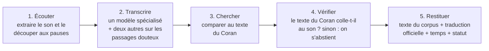
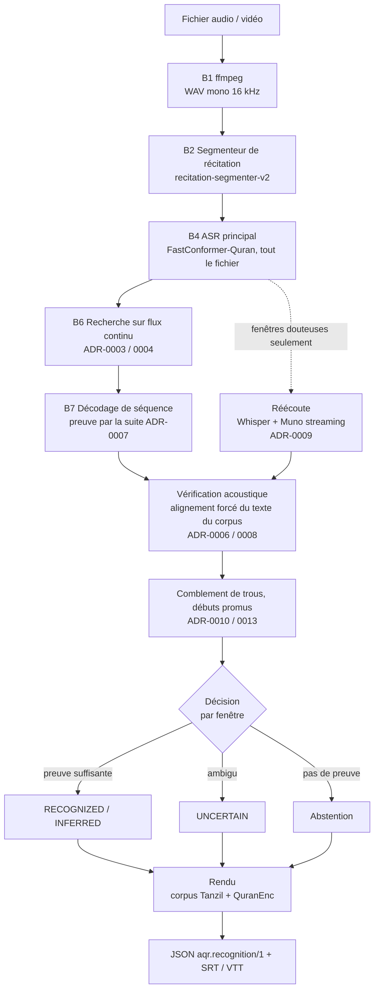

# IndabaX Sénégal 2026 — dossier source de la présentation

> Format : « AI Story / démo », 15 min de démonstration + 10 min de questions, public mixte (grand public curieux +
> techniciens IA/ML). Ce dossier est la **base** du futur PowerPoint : il ne contient ni diapositives ni code.
> Établi le **2026-11-18** à partir de `develop` @ `c5100de` (pointe au moment de l'écriture). Règle de lecture : chaque
> affirmation cite sa source (fichier, ADR ou PR) ; ce qui n'existe pas encore est marqué **« en construction »** ; aucun
> chiffre n'est inventé. Les chiffres que j'ai moi-même recomptés (git, GitHub) sont signalés « recompté le 2026-11-18 ».

---

## 0. Écarts avec la fiche (à lire en premier)

| # | Ce que dit la fiche | Ce que dit le dépôt | Action proposée |
|---|---|---|---|
| E1 | « 283 commits » | **286 commits** sur `develop` (recompté le 2026-11-18, `git rev-list --count origin/develop`), dont 20 commits de fusion, donc 266 hors fusions. **283 était exact au 2026-11-06.** | Annoncer « près de 290 commits » ou le chiffre recompté le jour J. |
| E2 | « 210 PR fusionnées » | **213 PR fusionnées** (GitHub, recompté le 2026-11-18) ; 6 ouvertes, 5 fermées sans fusion. **210 était exact au 2026-11-06.** | Idem : « plus de 210 PR ». |
| E3 | « construction en six semaines » | Premier commit le **2026-09-25**, dernier le **2026-11-17**, soit **53 jours = 7 semaines et demie** de calendrier, 23 jours avec au moins un commit. « Six semaines » vaut du 25 septembre au 6 novembre (pas de commit du 7 au 16 novembre). | Dire « environ sept semaines » (ou « six semaines de développement intense, du 25 sept. au 6 nov., puis des finitions »). Recompter le 18 déc. |
| E4 | « évaluations publiées » | Les **rapports** (chiffres, méthodes, limites) sont publics dans `docs/evaluation/`. Les **audios ne le sont pas** : lot de 12 audios réels = enregistrements de tiers, jeu privé, jamais redistribués (`docs/data-lots/RIGHTS.md`, KI-2). Résultat : on peut lire les mesures, pas les rejouer sans les fichiers. | Dire « rapports publiés, audio non redistribué pour des raisons de droits ». |
| E5 | « jeu de référence de 216 versets » | Exact : 3 récitants × 10 sourates (`chain-proof-2026-10-19.md`). Mais c'est un **plafond optimiste** (audio très probablement vu à l'entraînement des modèles) et la source est EveryAyah (usage interne, hors dépôt). | Toujours le présenter avec cette réserve. |
| E6 | « 12 audios réels = 8,7 h » | Exact : lot 1, 12 fichiers, 8,69 h (`docs/PLAN.md`, `nuit-2026-10-20.md`). **Aucune vérité terrain humaine** sur ces audios : « 740 versets reconnus » = 740 versets *nommés*, pas 740 *justes*. | Ne jamais dire « précision » pour ces audios. |
| E7 | « projet public » | Exact : dépôt GitHub **public** (recompté le 2026-11-18). Licence actuelle **MIT** ; la décision « licence non commerciale » n'est **pas encore appliquée** (`CREDITS.md`, `docs/SYSTEME-EN-BREF.md`). | Dire « code public, licence non commerciale décidée, en cours de bascule ». |
| E8 | « file d'analyse, PC GPU + serveur CPU de secours » | Exact (ADR-0017, notes du 2026-10-30) : le poste GPU est premier choix, le serveur Atlas (processeur seul) est le secours. | RAS. |

**Documents du dépôt qui retardent sur la réalité (à corriger avant la présentation, hors périmètre de ce dossier) :**

- `docs/SYSTEME-EN-BREF.md` §4 décrit la détection en direct comme « proposée, rien n'est codé » ; l'ADR-0011 dit que les étapes 1 à 4 sont livrées (rapports `live-etape1` à `live-etape4`).
- `README.md` (feuille de route) : le direct est en « Conception » et l'export de sous-titres en « Conception faite, implémentation à venir » ; les ADR-0014 et 0011 et les notes de version montrent l'inverse.
- `README.md` cite `docs/assets/demo-atelier.mp4` : **ce fichier n'existe pas** dans `docs/assets/` (seul `demo-atelier.webp` y est). Il faudra refaire un enregistrement d'écran pour le plan B (§7).
- `README.md` annonce « Réimport de 41 audios : +61 versets distincts, 0 perdu » : je n'ai **pas retrouvé** la source de ce chiffre dans `docs/` ni `.artist/`. Je ne l'utilise pas.

---

## 1. L'histoire et le problème

### 1.1 L'histoire en 3 phrases

1. On donne à un ordinateur un audio ou une vidéo quelconque (récitation, prière, cours qui mélange français, arabe courant et citations) et il doit dire **quels versets du Coran sont récités, de quelle seconde à quelle seconde**, en ignorant tout le reste (`docs/spec-v1.md`, `docs/SYSTEME-EN-BREF.md` §1).
2. Ce qui compte n'est pas de « trouver beaucoup » mais de **ne jamais afficher un faux verset** : le texte vient toujours du livre de référence, jamais d'une IA, et quand la preuve manque le système **s'abstient** (invariants I1 à I5, `docs/ARCHITECTURE.md` §1).
3. Le projet a été construit en environ sept semaines avec des agents IA, test d'abord, et sa valeur la plus nette est moins un modèle qu'une **couche de décision** qui fait mieux avec les mêmes modèles (`docs/SYSTEME-EN-BREF.md` §4).

### 1.2 Pourquoi c'est difficile

| Difficulté | Explication simple | Source |
|---|---|---|
| **Une récitation n'est pas un texte** | Le récitant s'arrête au milieu d'un verset, reprend, répète, saute, lit lentement ou très vite. Un « transcrire puis chercher » naïf ne suffit pas. | `docs/ARCHITECTURE.md` §4 (pièges 2 et 3) |
| **Chants et ornementation** | Une voix très ornée ou mal captée (récitation en public) est mal entendue : un fichier du lot sénégalais ne donne que 2 versets sur 6 minutes. Causes suspectées, **non vérifiées**. | `docs/evaluation/lot2-premiers-essais.md` §6 ; `docs/SYSTEME-EN-BREF.md` §5 |
| **Pauses et bruit** | Les pauses coupent les phrases ; la réverbération, le bruit, la vitesse changent ce que le modèle entend. | `docs/evaluation/courbe-degradation-2026-10-23.md` |
| **Parole libre autour** | Un cours mélange français, hadiths, invocations. Un modèle entraîné sur le Coran « voit du Coran partout » : il rattache n'importe quel arabe au verset le plus proche. | `docs/ARCHITECTURE.md` §4 (piège 1) |
| **Versets presque identiques** | Des refrains (ex. un verset répété 31 fois dans une même sourate) ; 289 versets (4,6 %) n'ont aucun début propre. | `docs/ARCHITECTURE.md` §4 (piège 3) ; `docs/adr/0011-detection-en-direct-sans-plage.md` |
| **Un faux verset est pire que rien** | Attribuer à un récitant un verset qu'il n'a pas dit est une faute, pas un « presque juste ». | Invariant I3, `AGENTS.md` |

**Phrase pour la salle :** « Ce n'est pas un problème de reconnaissance de parole, c'est un problème de *confiance* : quand ose-t-on nommer ? »

---

## 2. Les principes (invariants) expliqués simplement

Source des règles : `docs/ARCHITECTURE.md` §1, `AGENTS.md`, `docs/SYSTEME-EN-BREF.md` §3. Chaque pull request doit les respecter.

| # | Règle en clair | Pourquoi ça compte |
|---|---|---|
| **I1** | Le texte arabe affiché est **toujours tiré du corpus** (Tanzil, 6 236 versets) par consultation, **jamais produit par un modèle**. Aucun LLM génératif dans la chaîne (ADR-0001). | Un modèle génératif peut « corriger » un mot sans qu'on le voie. Ici l'affichage est exact par construction, même si le modèle entend mal. |
| **I2** | La traduction est celle de **QuranEnc, telle quelle**, avec son identifiant, sa version et son attribution. | Pas de reformulation silencieuse. Même une erreur de la source est montrée (KI-1 : phrase dupliquée en 42:3 et 42:4, `docs/KNOWN-ISSUES.md`). |
| **I3** | **Nommer un faux verset est pire que n'en nommer aucun.** La précision prime sur le rappel. | Dans le doute, le système **s'abstient**. On préfère en rater un que se tromper. |
| **I4** | La parole **non coranique** ne doit produire **aucun verset**. | Cours, hadiths, invocations restent hors résultat. **Honnêteté :** aujourd'hui elle sort en « abstention », pas encore avec une étiquette « non coranique » dédiée (`docs/RECOGNIZE-OUTPUT.md`, « Ce qui n'est pas fait » ; étape D, non commencée). |
| **I5** | Chaque résultat porte un **statut de preuve** : *reconnu* (entendu et vérifié sur le son), *supposé* (déduit d'un trou entre deux versets reconnus, jamais entendu), *incertain* (plusieurs versets possibles : ni texte ni traduction affichés). | Le lecteur sait toujours **sur quoi repose** ce qu'il lit. |
| I6 | La riwaya (mode de lecture) est un paramètre ; seul le **Hafs** est géré (décision du 2026-10-23). Une récitation en Warsh est reconnue comme du Hafs ; la sortie porte l'avertissement « riwaya supposée Hafs, non vérifiée ». | Deux signaux de détection testés ont échoué (`docs/evaluation/riwaya-2026-10-20.md`) : on affiche l'avertissement au lieu de prétendre détecter. |
| I7 | Chaque brique est remplaçable derrière une interface testée. | On peut changer de modèle sans réécrire le reste. |

**Statuts de preuve en une image (diapositive possible) :**

| Statut | Ce que l'écran montre | Ce que ça veut dire |
|---|---|---|
| RECOGNIZED (reconnu) | Verset, texte du corpus, traduction, temps de début et de fin | Entendu **et** confirmé : le texte du corpus colle à l'audio |
| INFERRED (supposé) | Verset marqué comme déduit, sans temps mesuré | Il se situe entre deux versets reconnus ; on ne l'a pas entendu |
| UNCERTAIN (incertain) | Liste des candidats, ni texte ni traduction | Plusieurs versets possibles ; on ne choisit pas |
| Abstention | Rien (ou « pas de verset nommé ») | Pas assez de preuve : **c'est une réponse valable** |

---

## 3. L'architecture en cascade

### 3.1 Version grand public : 5 blocs



Phrase clé : **« Le modèle ne sert qu'à localiser. Le texte, lui, vient du livre. »** (`README.md`, « Comment le moteur fonctionne »).

### 3.2 Version technique



Dessin ASCII équivalent (repris de `docs/SYSTEME-EN-BREF.md` §2, utile pour une diapositive sans Mermaid) :

```
 fichier  -> 1 EXTRAIRE (ffmpeg)  -> 2 DÉCOUPER (pauses)  -> 3 ÉCOUTER (FastConformer ;
 Whisper + Muno sur les seuls morceaux douteux) -> 4 CHERCHER (flux de mots du Coran)
 -> 5 CONFIRMER (suite de versets + vérification sur le son) -> 6 DÉCIDER (statut) 
 -> 7 RESTITUER (arabe du corpus + traduction + temps)
```

### 3.3 Rôle de chaque étage et modèles utilisés

| Étage | Rôle en une phrase | Modèle / méthode | Licence (source : `CREDITS.md`) |
|---|---|---|---|
| Extraction | Rendre tout format lisible | ffmpeg | — |
| Segmentation | Couper aux pauses de récitation | `recitation-segmenter-v2` | MIT |
| ASR principal | Transcrire tout le fichier | FastConformer-Quran | CC-BY-4.0 |
| ASR de réécoute (cascade) | Réécouter **seulement** les morceaux douteux | Whisper-Tarteel (base) ; FastConformer streaming « Muno » | Apache-2.0 ; NPL-1.1 (non commercial) |
| Recherche | Retrouver le verset le plus proche, tolérant aux erreurs du modèle | Index lexical en mémoire sur le **flux continu** du Coran ; pas de base vectorielle (ADR-0003, ADR-0004) | — |
| Décodage | Les versets courts se **confirment entre eux** dans la suite du Mushaf (ADR-0007) | Décodeur de séquence (calculs purs, testés sans modèle) | — |
| Vérification acoustique | Réaligner le **texte du corpus** sur le son ; s'il ne colle pas, rien n'est nommé (ADR-0006, 0008) | Alignement forcé CTC sur le modèle principal | — |
| Arbitre de la cascade | Un candidat de réécoute n'est gardé que si l'audio le soutient (ADR-0009) | Même vérificateur acoustique | — |
| Comblement | Combler un trou entre deux versets reconnus, promouvoir un début incertain par son voisin (ADR-0010, 0013) | Alignement + preuve par trame | — |
| Rendu | Texte arabe du corpus + traduction + temps (jusqu'au mot) | Tanzil (CC-BY-3.0) ; QuranEnc (sans modification) | — |

### 3.4 Pourquoi pas de LLM génératif (ADR-0001)

- Un LLM *génère* : il peut altérer un mot, il ne traite pas l'audio, il ne localise pas dans le temps (ADR-0001, option 2 rejetée).
- Choix retenu : **assembler des briques** — reconnaissance de la parole spécialisée → correspondance sur corpus fermé → décodage → consultation de base. Texte et traduction sont **consultés, jamais générés** (ADR-0001).
- Pas de base vectorielle ni de LangChain non plus : la recherche lexicale contrainte est plus simple et plus sûre (ADR-0003).
- **Une nuance honnête à connaître pour les questions :** un module « parole libre » (transcrire et traduire l'arabe *hors Coran* avec Whisper et un traducteur dédié) a été essayé (ADR-0027). Il **n'est jamais appliqué à du Coran**, il est **désactivé par défaut à l'export** et marqué « automatique, à vérifier ». La traduction mesurée est **mauvaise sur l'arabe religieux** (exemples dans l'ADR) : « aucun des deux traducteurs n'est publiable », décision : **rien en production**. À présenter comme **en construction / non retenu**, pas comme une fonctionnalité.

### 3.5 L'abstention comme fonctionnalité

- Statut `UNCERTAIN` + abstention sont des sorties normales, pas des échecs (I3, I5).
- Un début de verset « douteux » est promu par son voisin reconnu **seulement si l'audio le soutient** (ADR-0010).
- Cas d'école : sur la parole libre, « 0 verset nommé sur 3 600 s de parole » (banc du direct, `live-etape1-2026-10-23.md`) ; tafsir en wolof : « aucun faux verset sur 1 943 fenêtres », au prix de très peu de citations retrouvées (courtes : 2 à 4 mots) — `lot2-premiers-essais.md`.

---

## 4. Parcours d'un fichier, de l'envoi au résultat (la démo)

### 4.1 Les étapes et ce que le public voit

Application : l'**atelier web** « Quran TR » (Next.js 16, React 19 ; **aucune reconnaissance dans l'application web**, elle lance le moteur Python et relit son JSON — `docs/ARCHITECTURE-ATELIER.md` §1). Adresse publique prévue : `quran-tr.artist-dev.com` (`docs/INFRASTRUCTURE.md`) — **à vérifier en ligne avant le jour J**.

| # | Étape | Ce que le public voit | Ce qui se passe derrière | Durée indicative (source) |
|---|---|---|---|---|
| 1 | **Envoi** | Glisser-déposer d'un audio ou d'une vidéo (ou enregistrement au micro) ; liste de sessions | Import en flux, contrôle du contenu réel, copie d'écoute | instantané pour un fichier court (`ARCHITECTURE-ATELIER.md` §2, §6) |
| 2 | **File d'attente** | La session passe « en file » avec une **estimation du temps** ; on voit qu'on attend et pourquoi, sans voir les autres | File équitable (analyses et exports vidéo partagent la même file : une charge lourde à la fois, 5 en attente par compte au plus) | `docs/RELEASE-NOTES.md` (2026-10-29 « File d'attente visible », 2026-11-17) |
| 3 | **Analyse par un agent moteur** | « En cours » avec un pourcentage ; la session indique **quel agent** l'a faite | Un agent appelle l'atelier en HTTPS sortant, réclame le job, exécute le moteur, dépose le résultat. **Premier choix : poste à GPU. Secours : serveur Atlas, processeur seul.** | Atlas (CPU) : 11 min d'enregistrement en 27 s ; 716 s d'audio en 180 s (ADR-0017). Poste GPU, modèles chauds : 29 à 33 s (≈ 52 s à froid) pour un enregistrement de 2,6 Mo (ADR-0017, « Modèles gardés en mémoire ») |
| 4 | **Résultat** | Forme d'onde, pistes, verset en cours avec **statut de preuve**, texte du corpus, **traduction qui se surligne** fragment par fragment pendant l'écoute | Fichier `aqr.recognition/1` ; traduction découpée en fragments alignés sur les mots arabes (ADR-0012, 0026) | — |
| 5 | **Revue humaine** | On trace une plage fautive sur la forme d'onde, on choisit une puce (« verset faux », « début trop tard »…), on valide | Les décisions sont un **calque** posé sur une prédiction **immuable** (ADR-0014) ; elles servent aussi de cas de test | `README.md`, ADR-0014 |
| 6 | **Export vidéo / sous-titres** | Éditeur : cartes verset + traduction, onde, sourate, style, fond (vidéo d'origine ou autre) ; SRT, WebVTT, ASS (karaoké mot à mot) | Rendu **sur le serveur** par un navigateur sans interface + FFmpeg ; **1080p maximum** | `docs/EXPORT-SOUS-TITRES.md` ; ADR-0018 à 0023 ; notes du 2026-11-03 |
| 7 | **Découpage aux pauses** | Un long verset est montré **en plusieurs temps**, là où le récitant s'arrête ; chaque carte porte sa traduction exacte | Coupe à partir d'une pause de **0,9 s**, carte d'au moins **2 s** ; la traduction n'est coupée **que là où QuranEnc se coupe exactement**, sinon le verset reste entier avec ses mots surlignés un à un (ADR-0025 amendé par ADR-0029) | ADR-0029, PR #232 |
| 8 | **Page Téléchargements** | Une seule page : exports **prêts**, **en file**, **en cours** (pourcentage), **échoués** (message en français), annulables | File d'exports partagée avec les analyses ; visibilité appliquée côté serveur | ADR-0030, PR #233 (limite connue : la liste en file est en mémoire, un redémarrage l'efface) |
| 9 | **Réglages par vidéo** | En revenant sur une récitation, on retrouve exactement ses réglages (traduction, onde, style, fond…) | Mémorisés par vidéo, sauvegarde auto après une demi-seconde | ADR-0028, PR #231 |

Autres éléments utiles pour le décor (existent, ne pas tout montrer) : comptes avec rôle « récitant » (enregistrer et exporter sans le reste), playlists, invitations de testeurs par lien, page « Moteur » pour créer, révoquer et surveiller les agents, quota de **2 Go par compte** avec page « Téléchargements » (PR #223), API et MCP (`docs/API-MCP.md`), arrêt d'urgence (`AQR_SERVICE_MODE=restricted`).

### 4.2 Les agents moteur (infrastructure en 4 lignes)

```
 Navigateur  -->  Atelier (serveur Alpha, conteneur, derrière Traefik, sans GPU)
                       ^  HTTPS sortant, jeton d'agent, bail limité dans le temps
   Agent « poste GPU » (premier choix) ----+
   Agent « Atlas CPU » (secours)  ---------+   les agents APPELLENT l'atelier : aucun port ouvert chez eux
```

- Le serveur d'hébergement n'a pas de GPU et héberge d'autres projets : **le moteur tourne ailleurs** (ADR-0017). Le protocole est « l'agent appelle l'atelier » : aucune connexion entrante, le poste peut dormir.
- **Premier choix / secours** : le secours (Atlas) ne reçoit une analyse que si le premier choix est éteint, occupé ou révoqué ; au plus ~75 s d'attente avant le repli (notes du 2026-10-30).
- Panne : le job échoue **explicitement** (« le moteur distant a cessé de répondre »), jamais en silence (ADR-0017). Aucun moteur en ligne : les envois restent acceptés et attendent.
- Vie privée : l'agent supprime l'audio local à la fin de chaque analyse (ADR-0017). L'audio, lui, **quitte le poste de l'utilisateur pour le serveur** : à dire clairement (voir Q&A).
- Défauts trouvés en testant le déploiement réel et corrigés : toutes les routes protégées répondaient 403 (écoute sur `0.0.0.0`), puis les outils MCP se rappelaient en `https` sur un serveur en clair (PR #153 et #155, `docs/INFRASTRUCTURE.md`).

### 4.3 Et le direct ? (en construction côté qualité)

L'écran « En direct » (micro, flux WebSocket, sans plage déclarée) **existe** : étapes 1 à 4 livrées (ADR-0011) ; parcours complet éprouvé dans un vrai navigateur (11 scénarios, 168 contrôles, 0 en échec, `live-etape4-2026-10-24.md`). **Mais le rappel est limité** : sur deux enregistrements micro, le direct seul retrouve 4 versets sur 6 et 11 sur 22, sans verset en trop (ADR-0016) ; un « confirmateur » par le moteur du lot (ADR-0016) et un mode « récitation guidée » (la sourate est annoncée, ADR-0015) ont été ajoutés. **Statut pour la salle : fonctionnel, mesuré, pas au niveau du moteur par lots. Ne pas en faire la démo principale.**

---

## 5. Les évaluations : chaque chiffre avec sa source

### 5.1 Ce qui est mesuré

| Mesure | Résultat | Source |
|---|---|---|
| **Jeu de référence de 216 versets** (3 récitants × 10 sourates, EveryAyah) : versets *reconnus* | 71,8 % (155/216) → 91,2 % (197/216, preuve par la suite, ADR-0007) → 96,8 % (209/216, vérification acoustique, ADR-0008) → **97,7 % (211/216)** à la séance du 20 oct. ; **0 faux verset à chaque étape** | `chain-proof-2026-10-19.md`, `acoustic-check-2026-10-20.md`, `nuit-2026-10-20.md` |
| Même jeu avec la **cascade** (30 fichiers, split dev) | 211 → **216/216** versets distincts | `cascade-2026-10-20.md` |
| **12 audios réels, 8,7 h** (lot 1) : versets *reconnus* (nommés) | 618 (7 oct.) → 680 (ADR-0007) → **740** (séance du 20 oct.) | `nuit-2026-10-20.md` |
| Cascade contre moteur seul (lots 1 et 2, split dev) | **Aucun verset perdu** ; +10 versets distincts (lot 1), +5 (lot 2) ; **aucun verset ajouté sur les fichiers sans Coran récité** ; coût en temps **×2,85** (821 s → 2 337 s) | `cascade-2026-10-20.md`, ADR-0009 |
| Voix du mainteneur au micro (basmala puis 55:1-4) | Avant : aucun verset nommé. Après : 55:1-4 reconnu avec les trois moteurs | `nuit-2026-10-20.md` |
| Tafsir en wolof (lot 2) | **0 faux verset sur 1 943 fenêtres** ; très peu de citations retenues | `lot2-premiers-essais.md` |
| **Courbe de dégradation** (9 fichiers, 73 versets, 12,6 min d'audio) | Propre : 95,9 % (70/73). Bruit blanc 10 dB : 100 % ; réverbération moyenne : 97,3 % ; MP3 48 kbit/s : 98,6 % ; vitesse ×0,6 : 95,9 % ; **0 faux verset** à ces niveaux. Cela casse plus loin : bruit plus fort que la voix (−5 dB) 72,6 % (blanc) / 52,1 % (rose) ; grande nef 61,6 % ; récitation ×0,4 : 76,7 % ; ×0,3 : 41,1 %. Téléphone (AMR 4,75 kbit/s), MP3 8 kbit/s et bande à 4 kHz : 100 %. | `courbe-degradation-2026-10-23.md` |
| **Courbe de vitesse** (récitation lente) | Le facteur de compensation estimé gagne +11,0 points à ×0,4 (76,7 → 87,7 %) et +21,9 à ×0,3 (41,1 → 63,0 %), 0 faux verset, **mais l'étage n'est pas implémenté** : sur les vrais fichiers lents un seul gagne nettement, et dans la cascade complète le prototype ajoute **0 verset distinct**. | `courbe-vitesse-2026-10-23.md` |
| **Détection en direct, banc** (82 scénarios à vérité calculée) | **0 faux verrou sur 308 verrous** ; **0 verrou dans 42 zones non coraniques** ; premier verset nommé en médiane **5,3 s** (p90 9,1 s) ; facteur temps réel 0,060 sur CPU | `live-etape2-2026-10-24.md` |
| Latence du service WebSocket | Délai ajouté en médiane 14 à 39 ms avec le vrai modèle ; ≥ 24 flux simultanés avec moins d'1 s de retard ; réglage retenu 16 | `live-etape3-2026-10-24.md` |
| Écran « En direct » dans un navigateur | Premiers candidats affichés en médiane 2,2 s, verset nommé 4,0 s | `live-etape4-2026-10-24.md` |
| Traduction par fragments (sessions réelles, 811 passages partiels) | Avant ADR-0026 : 41 % exacts, 35 % approchés, **23 % retombaient sur le verset entier** | ADR-0026 |
| Recherche (phase 2b, fenêtres simulées) | 0 faux verset nommé ; top-1 98,8 % sur 7-12 mots ; ≈ 2 ms par requête | `docs/PLAN.md` (phase 2b) |

### 5.2 Ce qu'il faut dire sur ces chiffres (honnêteté)

- **Ce ne sont pas des taux de précision.** Sur les lots réels, aucune vérité humaine : « 740 reconnus » = « 740 nommés » (`docs/SYSTEME-EN-BREF.md` §5, « Ce que ces chiffres ne disent pas »).
- **EveryAyah est un plafond optimiste** : audio très probablement vu à l'entraînement ; « 0 faux verset » y est mesuré parce que les versets attendus sont connus.
- **La mesure de dégradation est saturée** dans la plage réaliste (le « propre » n'est pas un plafond : le taux d'erreur de transcription tombe de 13,4 % à 2,1-2,4 % dès que les aigus disparaissent) ; il faut des enregistrements réels annotés (`courbe-degradation-2026-10-23.md`).
- **Règle de décision écrite avant la mesure** pour les deux courbes (commit daté avant le premier calcul) : bon point de méthode à citer. Verdict de la dégradation : un fine-tuning avec dégradations n'est **pas** justifié par les quatre familles du cahier ; verdict de la vitesse : **pas d'étage « vitesse »**.
- **Les seuils ne sont pas calibrés sur une vérité humaine** ; ils le seront avec l'étape A (`docs/SYSTEME-EN-BREF.md` §5).
- Les fichiers du split « test » ne servent à aucun réglage (`protocole-reglage-evaluation.md`).

### 5.3 Échecs, limites et points ouverts (à assumer sur scène)

| Sujet | Constat | Source |
|---|---|---|
| **Vérité terrain humaine** | N'existe pas encore sur l'audio réel : 2 à 3 h à valider à l'oreille restent à faire (étape A). **Rien de ce qui précède n'est une précision mesurée sur audio réel.** | `docs/PLAN.md`, `docs/SYSTEME-EN-BREF.md` §4 |
| **Fine-tuning** | **Aucun n'a été fait** (étape C : seules les données sont préparées). Toute l'amélioration mesurée vient de la couche de décision, avec les mêmes modèles. | `docs/SYSTEME-EN-BREF.md` §4 |
| **Détecteur parole / récitation** | Étape D, **pas commencée** : la parole non coranique ne produit pas de verset mais n'a pas d'étiquette dédiée. | `docs/SYSTEME-EN-BREF.md` §6 |
| **Warsh** | Reconnu comme du Hafs ; aucun des deux signaux testés ne le distingue ; périmètre = Hafs seul. | `riwaya-2026-10-20.md` |
| **Récitation en public, très ornée** | Un fichier : 2 versets sur 6 min ; cause non vérifiée. | `lot2-premiers-essais.md` |
| **Citations courtes** (2 à 4 mots dans un cours) | Écartées volontairement (I3). | `docs/SYSTEME-EN-BREF.md` §6 |
| **Un mot isolé** | Peut encore être nommé dans une répétition de cours (un exemple relevé) : à surveiller. | `cascade-2026-10-20.md` |
| **Coût de la cascade** | ×2,85 en temps sur des fichiers parlés (jusqu'à ×3,2 sur le lot 1), faible sur une récitation continue. | `cascade-2026-10-20.md` |
| **Direct** | Le rappel est limité (4/6 et 11/22 sur deux essais micro avant confirmation). | ADR-0016 |
| **Parole libre (hors Coran)** | Traduction automatique **mauvaise** sur l'arabe religieux ; module désactivé à l'export, rien en production. | ADR-0027 |
| **Traduction de la sourate 42** | La source QuranEnc contient une phrase dupliquée en 42:3 et 42:4 ; restituée telle quelle (I2). | `docs/KNOWN-ISSUES.md` KI-1 |
| **Droits des audios du lot 1** | Enregistrements de tiers, jeu privé, jamais redistribué ; décision de droits **ouverte**. | `docs/data-lots/RIGHTS.md`, KI-2 |
| **Segmenteur de repli (Silero)** | Non fiable par défaut ; ne pas le présenter comme équivalent. | KI-3, `silero-fallback.md` |
| **Un bug trouvé en mesurant** | Le moteur de reconnaissance laissait son encodeur en mode entraînement après chaque transcription : sur un fichier, 68 versets reconnus tombaient à **5** après 30 passes. Trouvé, corrigé, couvert par un test de contrat (la mesure du 20 oct. est celle du code corrigé). | `acoustic-check-2026-10-20.md` §0 |
| **Un bug de désambiguïsation** | Le matcher coupait à `top_k = 5` et sortait le bon verset d'une liste de cinq jumeaux exacts. Corrigé (« `top_k` ne coupe jamais une égalité »). | `lot2-premiers-essais.md` (constat 5), `.artist/decision-log.md` (2026-10-20) |

---

## 6. La construction avec des agents IA

### 6.1 Les chiffres, vérifiés (recomptés le 2026-11-18)

| Mesure | Fiche | Recompté | Méthode |
|---|---|---|---|
| Premier commit | — | **2026-09-25** (« scaffold: nouveau projet ») | `git log --reverse origin/develop` |
| Dernier commit sur `develop` | — | **2026-11-17** (`c5100de`, PR #233) | `git log -1 origin/develop` |
| Commits sur `develop` | 283 | **286** (20 de fusion, 266 hors fusions) | `git rev-list --count origin/develop` |
| PR fusionnées | 210 | **213** (6 ouvertes, 5 fermées sans fusion) | `gh pr list --state all` |
| Durée | six semaines | **53 jours = 7 sem. 4 jours** ; 23 jours avec commits | dates des commits |
| Pic d'activité | — | 26 PR fusionnées le 2026-11-03 ; 24 le 2026-10-29 ; 22 le 2026-10-23 | `gh pr list --state merged` |

- 283 commits / 210 PR = l'état au **2026-11-06** (6 semaines pile). Il n'y a eu ensuite que 3 PR (17 novembre : #231, #232, #233). **Au 18 décembre le chiffre aura bougé** : recompter la veille (`git rev-list --count origin/develop` ; `gh pr list --state merged --limit 1000 --json number --jq length`).
- Nature des commits (préfixes, recompté) : 142 `feat`, 69 `fix`, 30 `docs`, 12 `test`, 6 `chore`, 3 `style`.
- Volume du dépôt (recompté, lignes de fichiers) : environ 31 600 lignes Python de moteur (`src/`), 33 900 lignes de tests Python (`tests/`), 130 000 lignes TypeScript pour l'atelier (`web/`, hors dépendances). Environ 2 200 fonctions de test Python (comptage de `def test_`, hors cas paramétrés) et 265 fichiers de test pour l'atelier. **Ordres de grandeur, pas des mesures de qualité.**
- Documentation : **30 ADR**, **150 entrées** de notes de version, **42 playbooks d'acceptation** (`.artist/acceptance-playbooks/`), un journal de décisions de près de 1 960 lignes (`.artist/decision-log.md`).

### 6.2 La méthode

| Pratique | En clair | Source |
|---|---|---|
| **TDD strict** | Test rouge → code → vert. Chaque bug vu sur un vrai audio devient d'abord un cas de test (`tests/fixtures/audio/manifest.yaml`). | `AGENTS.md` |
| **Invariants** | Cinq règles non négociables que chaque PR doit respecter (§2). | `AGENTS.md`, `docs/ARCHITECTURE.md` |
| **ADR** (décisions d'architecture) | Une page par décision, avec contexte, options, mesures. 30 à ce jour ; elles se **précisent et s'amendent** (ex. ADR-0029 amende ADR-0025). | `docs/adr/` |
| **Playbooks d'acceptation** | Le « terminé » est défini **avant** le code par des scénarios qui doivent passer (et d'autres qui doivent échouer). | `.artist/acceptance-playbooks/` |
| **Règle de décision écrite avant la mesure** | Pour les courbes de dégradation et de vitesse, la règle est commitée avant le premier calcul. | `courbe-degradation-2026-10-23.md`, `courbe-vitesse-2026-10-23.md` |
| **Architecture hexagonale** | Le cœur (normalisation, recherche, décodage, rendu) est pur et testé sans modèle ; les modèles lourds sont derrière des interfaces avec des tests de contrat. | `docs/ARCHITECTURE.md` §3, §6 |
| **Documentation vivante** | Toute PR qui change le comportement visible, l'architecture ou une décision ajoute une note de version dans la même PR. Un contrôle (`scripts/check_docs_index.py`) vérifie l'index et le format. | `AGENTS.md` |
| **Revues indépendantes et recettes QA** | Relecture indépendante de plusieurs PR (corrections tracées dans le journal) ; trois recettes QA de l'éditeur d'export. | `.artist/decision-log.md` (2026-10-09), `export-recette-qa*.md` |
| **Une PR par brique** | Fusionnée dans `develop`, la branche d'intégration. Rien n'est « fait » sans validation du mainteneur ; aucune publication sans son feu vert. | `AGENTS.md` |
| **Hooks Git** | `commit-msg` et `pre-push` empêchent toute signature d'IA dans l'historique ; un rappel non bloquant signale un changement sans note de version. | `.githooks/`, `AGENTS.md` |
| **Orchestration multi-agents** | Un orchestrateur garde le fil ; des spécialistes (développement, direction artistique, QA indépendant) exécutent. Exemple dans le dépôt : l'écran « En direct » a été conçu par l'agent de direction artistique (PR #108) puis implémenté (PR #110). | `docs/design/en-direct.md` ; **les définitions d'agents elles-mêmes ne sont pas dans le dépôt** (configuration personnelle du mainteneur, à présenter comme telle) |

**Point à trancher avant de monter sur scène (transparence).** La règle du dépôt interdit toute signature d'IA dans les commits et les PR (`AGENTS.md`, « Signature des commits et PR »). Conséquence : **l'historique Git ne dit pas que des agents IA ont écrit le code.** Pour un public mixte, la présentation doit donc **annoncer elle-même et clairement** le rôle des agents (c'est le sujet de la session) ; il vaut mieux que ce soit dit par le présentateur que découvert.

### 6.3 Leçons apprises et ce qui a mal tourné

| Leçon | Preuve dans le dépôt |
|---|---|
| **Le goulot était la décision, pas le modèle.** Sur de l'audio probablement vu à l'entraînement, le premier rapport réel ne retrouvait que 52,6 % des versets alors que l'ASR seul identifie 97 à 100 % d'entre eux. Trois briques de décision (preuve par la suite, vérification acoustique, cascade) ont fait monter le rappel à 97,7 % sur le jeu de référence, **sans réentraîner quoi que ce soit**. | `docs/PLAN.md` (direction A → B → C → D), `rapport-reel-2026-10-09.md` |
| **Mesurer d'abord, décider ensuite — y compris contre soi.** Le prototype « étage de vitesse » a été mesuré, a marqué des points sur le moteur seul, **n'a rien apporté dans la cascade** : il n'est pas livré. | `courbe-vitesse-2026-10-23.md` |
| **Les bugs viennent en mesurant.** Le bug du mode entraînement (68 → 5 versets) n'aurait pas été vu sans un banc comparant avec / sans sur les mêmes transcriptions. | `acoustic-check-2026-10-20.md` §0 |
| **Savoir renoncer.** Parole libre : deux traducteurs mesurés (dont un modèle de 17 Go), aucun publiable ; module désactivé, décision écrite. Détection du Warsh : deux signaux négatifs, abandon et avertissement permanent. | ADR-0027 ; `riwaya-2026-10-20.md` |
| **Des défauts en conditions réelles.** Le déploiement réel a révélé des erreurs invisibles en local (403 sur toutes les routes protégées) ; corrigées dans les PR #153 et #155. | `docs/INFRASTRUCTURE.md` |
| **Les affirmations vieillissent.** Plusieurs documents de synthèse retardent sur les ADR (voir §0) : une documentation « vivante » demande un contrôle, pas seulement une règle. | §0 de ce dossier |
| **Les agents vont vite, la preuve ne se délègue pas.** 26 PR en une journée est possible ; ce qui ne l'est pas, c'est la vérité terrain humaine (toujours manquante). | `docs/SYSTEME-EN-BREF.md` §4 |

---

## 7. Plan de présentation proposé (15 min) et questions probables

### 7.1 Minutage (12 diapositives, 15 min de démo + 10 min de questions)

Proposition : **les diapositives portent l'histoire, la démo porte la preuve.** Durées indicatives à répéter.

| # | Min | Diapositive | Message clé | Quoi montrer en direct |
|---|---|---|---|---|
| 1 | 0:00-0:45 | **Le problème** | « Dire quel verset est récité, à quelle seconde — sans jamais se tromper de verset. » | Rien (une image). |
| 2 | 0:45-1:45 | **Pourquoi c'est difficile** | Récitation ≠ texte : pauses, chants, bruit, parole libre ; un faux verset est pire que rien. | — |
| 3 | 1:45-2:45 | **Trois règles** | Texte du corpus jamais généré ; traduction non modifiée ; en cas de doute on s'abstient. | — |
| 4 | 2:45-3:45 | **Statuts de preuve** | Reconnu / supposé / incertain / abstention : on voit **sur quoi** repose chaque réponse. | — |
| 5 | 3:45-4:45 | **La cascade en 5 blocs** | Le modèle localise, le corpus fournit le texte, l'audio vérifie. | Schéma §3.1. |
| 6 | 4:45-9:15 | **DÉMO** — de l'envoi au résultat (4 min 30) | Un fichier, de bout en bout. | Envoi → file → agent moteur → résultat avec statuts, traduction surlignée → un passage **abstenu / incertain** montré exprès. |
| 7 | 9:15-10:30 | **DÉMO** — export vidéo (1 min 15) | Le résultat devient une vidéo sous-titrée ; coupe aux pauses. | Éditeur → page Téléchargements (une vidéo déjà prête). |
| 8 | 10:30-11:30 | **Comment on sait que ça marche** | Jeu de 216 versets : 71,8 % → 97,7 %, 0 faux verset ; 12 audios réels (8,7 h) ; courbes de dégradation et de vitesse. | Un seul graphique (progression par étape). |
| 9 | 11:30-12:30 | **Ce qu'on ne sait pas** | Pas de vérité humaine sur l'audio réel ; pas de fine-tuning ; direct à rappel limité ; parole libre non retenue. | — |
| 10 | 12:30-13:30 | **Construit avec des agents** | 286 commits, 213 PR (à recompter), ~7 semaines ; TDD, ADR, invariants ; **l'historique ne le dit pas, je le dis.** | Un extrait de la liste des ADR. |
| 11 | 13:30-14:30 | **Leçons** | La décision a compté plus que le modèle ; la preuve ne se délègue pas. | — |
| 12 | 14:30-15:00 | **Et après / appel** | Valider à l'oreille 2 à 3 h d'audio ; dépôt public ; contribuer sans coder. | Dépôt + QR code. |

Remarque de minutage : la démo (diapos 6 et 7) fait **5 min 45**, le reste est parlé. Si la salle pose vite des questions, **couper la diapo 11**.

### 7.2 Déroulé de la démo et choix de l'audio

- **Préparer 2 sessions déjà analysées** (une récitation propre, une avec parole non coranique et des passages incertains) **et 1 fichier court à envoyer en direct** (moins d'une minute). Sur le poste GPU (modèles chauds), une analyse courte prend de l'ordre de 30 s ; sur le secours CPU de l'ordre de la durée de l'audio divisée par quatre (mesures plus haut). **À chronométrer avant le jour J**, sur la connexion de la salle.
- **Montrer exprès un échec** : un passage en abstention ou `UNCERTAIN`, pour que le public voie que « ne rien dire » est un résultat, pas un bug.
- Dire à voix haute avant de lancer : « ce que vous allez voir n'est pas une précision mesurée sur cet audio ».
- Ne **pas** montrer en direct : parole libre / traduction automatique (non retenue), détection en direct (rappel limité) sauf en plan B ou en question.
- Écran propre : pas de compte administrateur ouvert, pas de jetons à l'écran, pas de liste de sessions d'autres comptes. Utiliser un compte de démonstration.

### 7.3 Plan B si la démo plante

| Panne | Réaction |
|---|---|
| Pas de réseau ou serveur injoignable | Lancer l'atelier **en local** sur le poste (`README.md`, « Démarrage ») avec une session déjà analysée ; sinon, enregistrement d'écran. |
| Analyse bloquée (agent hors ligne) | Montrer la page « Moteur » (agents, premier choix / secours) : **c'est une démo du secours** ; ouvrir la session pré-analysée. |
| Tout plante | **Vidéo d'écran du parcours complet, enregistrée la veille**, + captures. Le dépôt contient des captures (`docs/assets/*.jpg`, `demo-atelier.webp`) mais **pas** de MP4 (voir §0) : à produire. |
| Son coupé | Le résultat se lit sans le son (traduction surlignée) ; le dire. |

**Avant la salle, check-list :** URL de l'atelier joignable ; compte de démo ; agent GPU **et** agent de secours en ligne (page Moteur) ; session pré-analysée ouverte dans un onglet ; vidéo de secours sur le disque ; chiffres du dépôt recomptés (§6.1).

### 7.4 Questions probables et réponses courtes

**Techniques**

| # | Question | Réponse courte |
|---|---|---|
| 1 | Quelle précision ? | Je ne l'annonce pas : il n'existe pas de vérité terrain humaine sur l'audio réel. Sur un jeu de référence de 216 versets (plafond optimiste) : 97,7 % de versets reconnus, 0 faux. Sur 12 audios réels : 740 versets *nommés*, pas validés. (§5) |
| 2 | Pourquoi pas un LLM ou ChatGPT ? | Un LLM génère : il peut modifier un mot. Ici le texte vient du livre, par consultation (ADR-0001, I1). Le modèle ne sert qu'à localiser. |
| 3 | Pourquoi plusieurs modèles ? | Chaque moteur rate des passages que les autres entendent. FastConformer fait tout le fichier ; Whisper et Muno réécoutent **seulement** les passages douteux, et un candidat n'est gardé que si l'audio le soutient (ADR-0009). Coût ×2,85 en temps sur des fichiers parlés. |
| 4 | Avez-vous entraîné un modèle ? | Non. Aucun fine-tuning n'a été fait ; seules les données sont préparées (étape C). Les gains viennent de la couche de décision. |
| 5 | Comment évitez-vous les faux positifs sur la parole normale ? | Le texte du corpus doit **coller à l'audio** (alignement forcé) ; sinon on s'abstient. Banc : 0 verrou sur 3 600 s de parole ; 0 faux verset sur 1 943 fenêtres de tafsir en wolof (prix : peu de citations courtes retrouvées). |
| 6 | Et en temps réel ? | L'écran existe et tourne (facteur temps réel 0,06 sur CPU, premier verset nommé en médiane 5,3 s) mais le rappel est inférieur au moteur par lots (4/6 et 11/22 sur deux essais micro) : en cours d'amélioration. |
| 7 | Et le bruit, les voix différentes ? | Courbe de dégradation : robuste jusqu'à un bruit de 10 dB, casse quand le bruit dépasse la voix ; la mesure est saturée, il faut des enregistrements réels annotés. Accents sénégalais : bonne tenue en studio, difficulté en public (un fichier à 2 versets sur 6 min). |

**Grand public, éthique, religieux**

| # | Question | Réponse courte |
|---|---|---|
| 8 | Pouvez-vous vous tromper sur un verset ? | Oui, c'est possible ; c'est pourquoi chaque résultat a un statut de preuve, le système s'abstient dans le doute, et l'atelier permet de **corriger à l'oreille**. On ne l'utilise pas pour trancher un point de religion : c'est un outil d'**aide à la localisation**. |
| 9 | Qui vous donne la légitimité de toucher au texte sacré ? | Le système **ne touche pas au texte** : il le consulte tel quel dans un corpus public (Tanzil, non modifié) et la traduction officielle de QuranEnc, sans modification (I1, I2). Aucune « reformulation par IA ». La relecture humaine reste nécessaire. |
| 10 | La traduction est-elle correcte ? | C'est celle de QuranEnc, restituée telle quelle, avec sa source ; on montre même ses défauts (ex. phrase dupliquée en 42:3-42:4, KI-1). On n'applique **aucun** modèle de traduction au Coran. |
| 11 | Que devient mon audio, ma vie privée ? | L'audio est envoyé au serveur de l'atelier et analysé par un agent qui **supprime sa copie locale à la fin** ; quota de 2 Go par compte ; comptes, sessions privées par défaut. Le serveur héberge d'autres projets : à ne pas confier d'enregistrement sensible. *(Source : ADR-0017, PR #223. À compléter par le présentateur sur la politique de conservation.)* |
| 12 | Les droits d'auteur des récitants ? | **Question ouverte et assumée.** Les audios de test viennent de récitations publiques (EveryAyah) et d'enregistrements de tiers ; usage **interne d'évaluation**, hors dépôt, jamais redistribués, jeu de données privé (`docs/data-lots/RIGHTS.md`, KI-2). L'outil ne republie pas les audios ; en revanche l'export vidéo peut recomposer une récitation : l'utilisateur doit avoir les droits (`README.md` : « n'importe que des audios dont tu as les droits »). |
| 13 | Quelle licence ? Est-ce libre d'utilisation ? | Le code est public, sous MIT **aujourd'hui** ; le mainteneur a décidé un usage **non commercial** et une licence non commerciale, **bascule non faite** (`CREDITS.md`). Raison pratique : certains modèles (Muno NPL-1.1) et données sont non commerciaux. Nuance à connaître : une licence « non commerciale » n'est pas, au sens strict, une licence « open source ». |
| 14 | Quelles lectures du Coran sont gérées ? | Le **Hafs** uniquement ; une récitation en Warsh serait reconnue comme du Hafs, avec l'avertissement « riwaya supposée Hafs, non vérifiée ». Deux signaux de détection ont été testés sans succès. |
| 15 | L'IA va-t-elle remplacer les récitants ou les enseignants ? | Non : l'outil retrouve et sous-titre, il ne juge ni le tajwid ni la justesse de la lecture (hors périmètre de la V1, `docs/spec-v1.md`). |
| 16 | Avez-vous vraiment écrit tout ça avec des agents IA ? | Oui : c'est le sujet. Les agents ont écrit une grande partie du code et des tests ; le mainteneur a fixé les règles, tranché les décisions et validé. Ce qu'ils **ne remplacent pas** : la vérité terrain humaine. |
| 17 | Pourquoi seulement six / sept semaines ? | Parce que les décisions étaient écrites avant le code (ADR, playbooks) et que les tests rendent les agents rapides **et** surveillables. Rapidité du code ≠ qualité des données. |

---

## 8. Glossaire grand public

| Terme | En clair |
|---|---|
| **ASR** (reconnaissance automatique de la parole) | Un programme qui transforme une voix en texte. Ici : spécialisé dans la récitation. |
| **Corpus** | Le texte de référence du Coran (6 236 versets) tel qu'on l'a téléchargé de Tanzil. Le système n'écrit jamais un verset autrement qu'à partir de lui. |
| **Cascade** | Une chaîne où un premier modèle fait tout le travail, et d'autres n'interviennent que sur les cas douteux. |
| **Abstention** | Ne rien répondre quand la preuve manque. Une réponse valable, pas une panne. |
| **Statut de preuve** | Étiquette sur chaque résultat : reconnu, supposé, incertain. |
| **Faux positif / faux verset** | Un verset annoncé alors qu'il n'a pas été récité. Le pire cas ici (invariant I3). |
| **Rappel / précision** | Rappel : combien de versets récités on retrouve. Précision : parmi ceux annoncés, combien sont justes. Ici la précision passe avant le rappel. |
| **Vérité terrain** | Une réponse juste établie par un humain, qui sert de règle pour mesurer. **Elle manque encore sur l'audio réel.** |
| **Alignement forcé** | On prend un texte connu et on cherche à quel moment précis chaque mot est dit dans l'audio ; si ça ne colle pas, le texte n'est pas là. |
| **Fine-tuning** | Réentraîner un modèle existant pour une tâche précise. **Pas fait** dans ce projet. |
| **LLM génératif** | Un modèle de langage qui produit du texte (type assistant de conversation). **Absent de la chaîne** qui touche au Coran. |
| **ADR** | « Architecture Decision Record » : une page qui garde la raison d'un choix technique. 30 dans le dépôt. |
| **TDD** | On écrit le test avant le code : le test échoue, on code, il passe. |
| **Riwaya (Hafs, Warsh)** | Mode de lecture du Coran. Seul le Hafs est géré. |
| **Plafond optimiste** | Un résultat obtenu dans des conditions trop favorables (ici : audio probablement vu à l'entraînement) : ce n'est pas ce qu'on aura dans la vraie vie. |

---

## 9. Sources et fichiers utilisés

**Consignes et méthode :** `AGENTS.md`, `CLAUDE.md`, `README.md`, `CREDITS.md`, `CONTRIBUTING.md`, `.artist/decision-log.md`, `.artist/acceptance-playbooks/`, `.githooks/`.

**Vue d'ensemble et architecture :** `docs/SYSTEME-EN-BREF.md`, `docs/ARCHITECTURE.md`, `docs/ARCHITECTURE-ATELIER.md`, `docs/PLAN.md`, `docs/spec-v1.md`, `docs/INFRASTRUCTURE.md`, `docs/RELEASE-NOTES.md`, `docs/docs-index.json`, `docs/KNOWN-ISSUES.md`, `docs/EVALUATION-METRICS.md`, `docs/EXPORT-SOUS-TITRES.md`, `docs/RECOGNIZE-OUTPUT.md`, `docs/API-MCP.md`, `docs/design/en-direct.md`.

**Décisions (ADR) citées :** 0001 (pas de LLM génératif), 0003 et 0004 (recherche lexicale sur flux continu), 0006 à 0010 (alignement forcé, preuve par la suite, vérification acoustique, cascade, promotion par le voisin), 0011, 0015 et 0016 (direct, récitation guidée, confirmation par le lot), 0012 et 0026 (traduction par fragments), 0013 (comblement de trou), 0014 (décisions humaines sur prédiction immuable), 0017 (moteur à distance), 0018 à 0023 (éditeur d'export), 0025 et 0029 (coupe aux pauses, traduction exacte), 0027 (parole libre), 0028 (réglages par vidéo), 0030 (page Téléchargements).

**Évaluations (`docs/evaluation/`) :** `rapport-reel-2026-10-09.md`, `chain-proof-2026-10-19.md`, `acoustic-check-2026-10-20.md`, `cascade-2026-10-20.md`, `nuit-2026-10-20.md`, `lot2-premiers-essais.md`, `riwaya-2026-10-20.md`, `courbe-degradation-2026-10-23.md`, `courbe-vitesse-2026-10-23.md`, `comblement-de-trou-2026-10-23.md`, `traduction-par-passage-2026-10-23.md`, `live-etape1-2026-10-23.md`, `live-etape2-2026-10-24.md`, `live-etape3-2026-10-24.md`, `live-etape4-2026-10-24.md`, `asr-comparison.md`, `silero-fallback.md`, `protocole-reglage-evaluation.md`.

**Données et droits :** `docs/data-lots/RIGHTS.md`, `docs/data-lots/ref-corpus-provenance.md`, `docs/data-lots/lot-1.yaml`, `docs/data-lots/lot-2.yaml`.

**Comptages faits pour ce dossier (2026-11-18)** : `git rev-list --count origin/develop`, `git log origin/develop` (dates, préfixes, signatures), `gh pr list --state all --limit 1000`, `gh repo view` (visibilité, licence), comptage de fichiers et de lignes dans `src/`, `tests/`, `web/`.

**Hors dépôt (à confirmer par le présentateur) :** les définitions des agents spécialisés (orchestrateur, développement, direction artistique, QA) vivent dans la configuration personnelle du mainteneur, non versionnée ; l'état réel du serveur public et des agents le jour de la démonstration.
