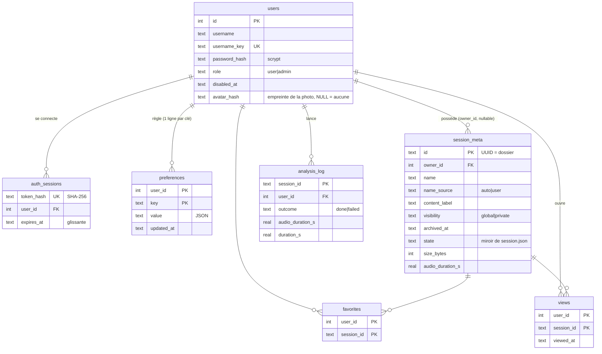

# Artist Quran Review — démarrage local

L'interface Next.js appelle **`aqr recognize`**, le moteur Python existant. Elle reste sur `127.0.0.1`. Un essai conserve son audio, sa prédiction originale et les révisions de revue dans `AQR_REVIEW_DIR` (par défaut `%LOCALAPPDATA%\aqr-review` sous Windows, `$XDG_DATA_HOME/aqr-review` ou `~/.local/share/aqr-review` ailleurs), hors Git. Aucun envoi cloud automatique.

## Préparer

Depuis la racine du dépôt, installer les dépendances Python et le corpus selon `AGENTS.md`. Les modèles restent hors dépôt dans `AQR_MODELS_DIR`. Dans `web/`, exécuter `npm ci`.

Sous PowerShell :

```powershell
$env:AQR_PYTHON = 'D:\01-Dev\Perso\artist-quran-recognizer\.venv\Scripts\python.exe'
$env:AQR_MODELS_DIR = 'D:\01-Dev\Data\aqr-models'
$env:AQR_CORPUS_DIR = 'D:\01-Dev\Perso\artist-quran-recognizer\data\corpus'
$env:AQR_REVIEW_DIR = 'D:\01-Dev\Data\aqr-review'
cd web
npm run dev
```

Ouvrir l'URL affichée par Next.js. L'atelier lance la cascade (FastConformer partout, Whisper et Muno réécoutent les fenêtres douteuses, arbitre acoustique : ADR-0009) et le segmenteur de récitation ; l'interface ne propose plus de choisir le moteur. `AQR_ASR=fastconformer` (ou `whisper`, `muno-streaming`) force un moteur seul, pour une mesure. La première analyse peut durer plusieurs minutes. Le temps affiché est réel, sans pourcentage simulé. Un échec de modèle, de corpus ou d'extraction apparaît dans la session.

## Écoute exacte et pistes synchronisées

Le lecteur ne joue pas le fichier importé mais sa **copie d'écoute** : le même décodage ffmpeg que le moteur (mono, 16 kHz), en WAV PCM, rangé dans `sessions/<id>/listening/`. Raison : dans un MP3 à débit variable (cas des fichiers extraits de vidéos), le navigateur se positionne à plusieurs secondes de l'instant demandé (mesuré sur 45 min : +7,9 s à 42:22, −10,3 s à 20:00), alors que les temps du JSON sont comptés sur le PCM du moteur. Avec la copie d'écoute, l'écart mesuré est inférieur à 0,05 s et la durée est identique à l'échantillon près. Le badge du lecteur l'indique (« ÉCOUTE = AUDIO DU MOTEUR ») ; si ffmpeg échoue, l'original est joué et le badge passe à « ORIGINAL · POSITION APPROXIMATIVE ».

- La copie est préparée en tâche de fond dès l'import (≈ 20 s pour 45 min), sinon à la première écoute ; elle est régénérée si l'audio source change. `AQR_FFMPEG` désigne l'exécutable (défaut : `ffmpeg` du PATH, comme le moteur).
- Fichiers dérivés : jamais dans le pack ZIP, jamais comptés comme activité de revue (`AQR_SESSION_TTL_S`), supprimés avec la session.
- La forme d'onde vient des crêtes calculées par le serveur (`GET /api/sessions/<id>/peaks`, `aqr.listening-peaks/1`, 50 par seconde) : rien n'est décodé dans le navigateur, même pour 2 h d'audio.
- Les intervalles du moteur sont posés **sur la forme d'onde** (référence du verset quand la place le permet) ; un clic place le lecteur sur leur début. La **fenêtre visible** (fichier entier, 10 min, 2 min, 30 s, 10 s) règle à la fois la forme d'onde et les pistes, qui partagent un seul repère temporel. « Suivre la lecture » garde la tête de lecture au centre.
- « Écouter ce passage », sur la carte, joue exactement l'intervalle affiché puis s'arrête.

## Tester un audio

1. **Nouvel essai** (bouton de la barre du haut) : déposer ou choisir **plusieurs** audios et vidéos d'un coup (MP3, M4A, WAV, OGG, OPUS, FLAC, AAC ou WebM ; 500 Mo maximum par défaut — MP4, MKV, MOV, AVI, M4V ou WebM ; 2 Gio maximum par défaut, seule la piste sonore est analysée). Chaque fichier est importé dès qu'il est choisi et **mis dans la file d'analyse** (`autorun`) ; un glisser-déposer n'importe où dans la page fait la même chose. Un seul fichier s'ouvre tout seul ; plusieurs restent dans la file, visible dans le panneau des sessions. Ou « Enregistrer une récitation » : autoriser l’accès au micro sur `127.0.0.1`, démarrer, surveiller la durée, arrêter, réécouter et recommencer ; « Analyser cette récitation » importe les octets originaux WebM/OGG/M4A et met l'analyse en file. Un refus d’accès ou un micro indisponible affiche une erreur ; aucun fichier n’est créé avant le choix d’analyser.
2. Facultatif (accordéon « Importer aussi un résultat existant ») : un JSON `aqr.recognition/1` du **même audio**. Le hash SHA-256 est contrôlé ; la prédiction importée garde ses octets d'origine ; le moteur ne tourne pas.
3. Le panneau des sessions montre l'état de chaque analyse : en attente (rang dans la file), en cours (estimation du temps restant), terminée non lue (point), lue, en échec, annulée. Ouvrir une session terminée efface son point.
4. Utiliser l'onde, les pistes, la liste des intervalles et le lecteur pour écouter. Les hypothèses déduites et les abstentions ont leurs propres affichages. « Sans temps » ne déplace pas le lecteur.
5. **Signaler** (panneau de droite) : donner un pseudonyme, délimiter le passage (voir « Revue humaine »), choisir des puces, confirmer. La revue se sauvegarde sur cet ordinateur ; vérifier l'indicateur « Enregistré sur cet ordinateur ».
6. Télécharger le pack ZIP complet (onglet « Signalements ») pour le transférer dans un environnement cloud autorisé. Il contient l'audio, la prédiction originale, la revue courante (tous les testeurs), ses révisions et un manifeste d'empreintes SHA-256. Le bilan JSON seul est aussi disponible. Le stockage cloud, les droits sur des voix tierces et une vérité terrain exhaustive restent à établir avant d'annoncer des métriques.

## Mesurer la fluidité (longs audios)

`e2e/perf-measure.mjs` rejoue les gestes d'un testeur sur une session et mesure, dans le navigateur : images (deltas de `requestAnimationFrame`), tâches longues, latence geste → image peinte, commits React, nœuds DOM, écouteurs, mémoire JS, temps de style et de mise en page. **Build de production seulement** (`npx next build` puis `npx next start`, jamais `next dev`) et **sur une copie** des sessions : jamais sur le serveur ni les données du mainteneur.

```powershell
$env:AQR_REVIEW_DIR = 'D:\01-Dev\Data\aqr-review-perf'   # copie d'une session de 2 h dans sessions\<id>\ (listening\ compris)
$env:AQR_DB_PATH    = 'D:\01-Dev\Data\aqr-review-perf\aqr.sqlite'
npx next start --hostname 127.0.0.1 -p 3872
node e2e/perf-measure.mjs --url http://127.0.0.1:3872 --session <uuid> --headed --label apres --out resultats.json
```

Sans `--user`, un compte jetable est créé par l'inscription. Scénarios (`--only open,jumps,burst,keys,play,live,pan,span,leak`) : ouverture, 50 sauts par clic dans la liste, 50 sauts à chaque image, 50 flèches du clavier, lecture, lecture avec surlignage des mots, glisser de la timeline, changement de fenêtre visible, mémoire après 3 × 50 sauts. Options utiles : `--headed` (vrai GPU, cadence réelle de l'écran : un écran à 240 Hz a un budget de 4 ms par image), `--cpu 4` (processeur ralenti 4 ×), `--mobile` (375 px), `--trace jumps,play` (temps par phase du navigateur : mise en page, peinture, composition, plus les tâches les plus longues), `--profile jumps` (échantillonnage JS), `--inject-css ".tl-lane{display:none}"` (retire une zone pour lui attribuer son coût). Objectifs : navigation entre versets sans tâche longue (> 50 ms), latence au 95ᵉ centile ≤ 50 ms, lecture sans tâche longue, nœuds DOM bornés (≈ 1 000 pour 3 000 intervalles), mémoire stable.

## Interface : design, panneaux, polices

Direction « Encre & lapis » (`docs/design/atelier-direction.md`, tokens dans `docs/design/tokens.css`). `app/tokens.css` en est la copie, **identique** (un test le vérifie) ; aucune feuille ne porte de valeur visuelle en dur. Chaque zone a son composant (`app/atelier/*`) ; la logique pure vit dans `lib/` et est testée.

- **Thème** : suit le système ou le choix du compte (préférence `theme`, enregistrée côté serveur). `app/layout.tsx` pose thème, police arabe et taille sur `<html>` **côté serveur**, avant le premier rendu (pas de flash) ; sur les pages sans compte (connexion), un petit script reprend le thème mémorisé par le navigateur (`aqr.prefs.v2`).
- **Panneaux** : sessions à gauche, revue humaine à droite, repliables (état mémorisé). Sous 1280 px ce sont des tiroirs (focus piégé, Échap, voile). La pastille du bouton de gauche signale du non lu ou une analyse en cours panneau fermé ; le titre de l'onglet porte le total non lu. Le panneau de revue n'existe que sur une session ouverte.
- **Mobile (375 px)** : le passage actif passe avant la console, le lecteur est ancré en bas, le bouton drapeau du lecteur pose le début/la fin d'un signalement sans ouvrir le tiroir.
- **Rafraîchissement** : la liste est sondée toutes les 3 s onglet visible avec une analyse active (10 s sinon, 15 s en arrière-plan) et au retour de l'onglet. Le point « non lu » ne disparaît que lorsqu'on **ouvre** le résultat (`POST /api/sessions/<id>/viewed`), jamais par le sondage.
- **Raccourcis** : `M` (début puis fin), `P` (point), `L` (boucle), `Échap` (annuler la pose), `Ctrl+Entrée` (confirmer), `Espace` (lecture). Inactifs dans un champ de saisie, désactivables dans « Raccourcis clavier ».

### Polices

- **Latines (SIL OFL 1.1), embarquées** dans `public/fonts/` avec leur texte de licence : Instrument Serif, Atkinson Hyperlegible Next et Mono (woff2, sous-ensemble latin). Aucune requête vers un service de polices : l'atelier fonctionne hors ligne. Repli défini dans les tokens si un fichier manque.
- **Arabes (SIL OFL 1.1), embarquées** : Amiri Quran, Scheherazade New, Noto Naskh Arabic.
- **KFGQPC Uthmanic Hafs V30** (choix du mainteneur) : fichier sous licence « tous droits réservés » du Complexe du Roi Fahd. **Jamais dans Git ni dans `public/`** (le dépôt l'ignore, un test le garantit). Il est servi par `GET /api/fonts/kfgqpc-hafs-v30` depuis le dossier **`AQR_FONTS_DIR`** (défaut explicite : `%LOCALAPPDATA%\aqr-fonts` sous Windows, `$XDG_DATA_HOME/aqr-fonts` ou `~/.local/share/aqr-fonts` ailleurs), nom de fichier `KFGQPC-Hafs-V30.ttf`, liste blanche stricte de noms (aucun chemin n'est construit à partir de la requête), **boucle locale seulement** : même en mode test distant avec jeton, un hôte autorisé ne reçoit jamais la police. Absente, l'option est grisée avec l'explication et la pile retombe sur Amiri Quran. Sans choix mémorisé, Hafs V30 est préférée quand elle est installée. `GET /api/fonts` dit quelles polices locales sont présentes.
- Le sélecteur (« Police arabe » dans la carte du passage) règle police et taille (28 à 72 px par pas de 4), avec aperçu en direct, mémorisé. L'aperçu utilise le début du passage affiché (texte du corpus) ou des lettres arabes qui ne sont pas du Coran.

### Formules et basmala (invariant I1)

La carte du passage montre la **basmala** comme un verset (arabe du corpus, traduction QuranEnc, badge « Basmala ») dès que la sortie JSON porte son texte. **Isti'adha, takbir et âmîn** sont des constantes de l'interface (`lib/formulas.ts` : arabe + traduction française) affichées avec la mention « Formule — hors Mushaf, traduction indicative (non QuranEnc) » : elles ne viennent ni du corpus ni de QuranEnc et ne sont jamais présentées comme telles. Les `[1]` des traductions sont stylés en exposant **à l'affichage seulement** (la chaîne n'est jamais modifiée, I2).

## Revue humaine (`aqr.review/2`)

Trois onglets : **Signaler**, **Signalements** et, pour les **administrateurs** seulement (`role: "admin"`, voir « Comptes, partage et préférences »), **Vérité terrain** (il écrit dans le manifeste de test : les testeurs n'y touchent pas ; `?relecteur=1` n'a plus d'effet côté serveur, qui refuse en `403`).

- **Délimiter** : un seul bouton « Marquer le début » puis « Marquer la fin » (`M`), un point (`P`), ou **tracer sur l'onde** (mode « Tracer sur l'onde » ou `Maj` + glisser : glisser = plage, toucher = point ; `touch-action: none` en mode tracé). Une plage dure au moins 0,2 s ; les valeurs sont au dixième de seconde. Les poignées de la plage s'ajustent à la souris, au doigt ou aux flèches (0,1 s ; `Maj` : 1 s), ou avec − / + / « caler sur la lecture ».
- **Brouillon** enregistré dès la pose (puis 500 ms après chaque frappe), écoute de la plage (en boucle possible ; l'écoute est **indicative**, elle ne bloque pas la confirmation), 23 puces en 7 familles (`lib/review-presets.ts`, la seule source des libellés), verset attendu (`sourate:verset`, vérifié), commentaire (3 000 caractères). Un signalement se confirme avec au moins une puce ou un commentaire.
- **Suppression** sans boîte de dialogue : « Annuler » pendant 6 s, ensuite elle devient réelle.
- **Testeur** : le pseudonyme du **compte connecté** (2 à 24 caractères, jamais une adresse e-mail), copié dans chaque signalement par le serveur — le client ne choisit plus son nom. Le signalement d'un autre testeur ne se modifie pas (sauf administrateur : son nom reste, `updated_by` note le modificateur).
- **Liste** : filtres testeur et état (ils valent aussi sur l'onde et la piste Revue), clic = saut à l'instant et surlignage de la plage ; losange plein = confirmé, creux = brouillon.

**Modèle.** `aqr.review/2` ajoute à chaque annotation `tags` (puces, ids stables), `tester`, `updated_by?`, `created_at` ; `type` (historique d'`aqr.review/1`) est dérivé du premier tag pour ne pas changer les exports. La lecture est rétro-compatible : une revue `aqr.review/1` se lit avec des `tags` dérivés de `type` et `tester: "inconnu"` (le fichier n'est réécrit qu'au premier enregistrement).

**Écriture multi-testeurs.** `GET /api/sessions/<id>/review` renvoie la revue complète. `PUT /api/sessions/<id>/review` ne **remplace** plus la liste : le client n'envoie que ce qu'il a modifié (`annotations`) et ce qu'il supprime (`deleted_ids`), le serveur **fusionne par `id`** sous verrou (lecture, fusion, écriture) — le dernier `updated_at` gagne par identifiant, `tester` et `created_at` ne changent jamais après la création — et répond `{ saved, review }` avec la revue fusionnée. Le client la rafraîchit aussi toutes les 15 s. Une révision de l'état précédent est conservée à chaque changement réel.

## File d'attente, vidéos, « non lu » et durées (contrat d'API)

Plusieurs analyses peuvent être lancées à la suite (audios et vidéos) : le serveur les met en **file FIFO** et n'en exécute qu'une à la fois (la carte graphique n'aime pas le parallèle). Le client envoie un fichier par requête, autant de fois qu'il veut, et revient plus tard.

| Variable | Rôle | Défaut |
| --- | --- | --- |
| `AQR_MAX_CONCURRENT` | analyses exécutées en même temps (entier ≥ 1 ; invalide = 1). Lue à chaque démarrage d'analyse | `1` |
| `AQR_MAX_VIDEO_UPLOAD_BYTES` | plafond d'une **vidéo** envoyée en flux (`413` au-delà). Une vidéo garde son image sur le disque alors que seul le son sert : 2 Gio couvrent 1 h 30 de 1080p courant | 2 Gio |
| `AQR_MAX_UPLOAD_BYTES` | plafond d'un **audio** en flux, et de tout envoi par formulaire multipart (lu en mémoire) | 500 Mo |
| `AQR_FFPROBE` | exécutable ffprobe (défaut : voisin de `AQR_FFMPEG`, sinon `ffprobe` du PATH, comme le moteur) | — |

### Importer (`POST /api/sessions`)

- **En flux (recommandé, seul adapté à une vidéo)** : le corps est le fichier lui-même, écrit directement sur le disque (jamais lu en mémoire), empreinte calculée au vol.
  ```js
  await fetch("/api/sessions?autorun=1", {
    method: "POST",
    headers: {
      "x-aqr-filename": encodeURIComponent(file.name), // obligatoire (extension reconnue)
      "x-aqr-source-kind": "file",                      // ou "microphone" (facultatif)
      "content-type": file.type || "application/octet-stream",
    },
    body: file, // le navigateur lit le File par morceaux
  });
  ```
- **Formulaire multipart** (compatibilité) : champ `audio` (ou `media`), `result` facultatif (JSON `aqr.recognition/1` du même audio), `source_kind`, `autorun=1`. Lu en mémoire : plafond `AQR_MAX_UPLOAD_BYTES` pour tous les types.
- `?autorun=1` (ou `true` ; ou le champ `autorun` du formulaire) met l'analyse en file dès l'import ; la réponse est alors la session déjà `queued` ou `running`. Si la mise en file échoue (moteur non configuré…), l'import n'est pas perdu : la session reste `ready` et la réponse porte `autorun_error`.
- Réponses : `201` + session ; `400` format non accepté / fichier vide / flux interrompu / résultat d'un autre audio ; `413` au-delà du plafond ; `422` **fichier sans piste audio** (vidéo muette) ou **illisible/corrompu** (audio comme vidéo : refus à l'import, pas un échec de l'analyse plus tard), dans les deux cas rien n'est conservé ; `403` hors accès local.
- Formats : audio MP3, M4A, WAV, OGG, OPUS, FLAC, AAC, WebM ; vidéo MP4, MKV, MOV, AVI, M4V (et WebM). ffprobe sonde le fichier à l'import (piste audio présente, durée de la **piste audio**, pas du conteneur) ; sans ffprobe le fichier est accepté sans durée (et sans estimation) et c'est le moteur qui refusera un fichier sans audio. Helpers côté client : `lib/audio-upload.ts` (`mediaAccept`, `isAcceptedMediaName`, `isVideoName`, `acceptedMediaFiles`, `bindMediaDrop` pour un dépôt multiple).

### États et champs d'une session (`GET /api/sessions`, `GET /api/sessions/<id>` → `session`)

`GET /api/sessions` renvoie un tableau, les plus récentes d'abord. Champs ajoutés (les anciens sont inchangés) :

| Champ | Type | Sens |
| --- | --- | --- |
| `state` | `ready` · `queued` · `running` · `done` · `failed` · `cancelled` | `queued` = en attente de la file |
| `queue_position` | entier ≥ 1 ou `null` | rang dans l'attente (1 = la prochaine) ; calculé à la lecture, `null` hors attente |
| `queued_at` | ISO ou `null` | mise en file ; strictement croissant dans l'ordre de la file, c'est l'ordre FIFO durable (reste renseigné après le départ) |
| `started_at` / `finished_at` | ISO ou `null` | départ réel du processus / fin (réussite, échec ou annulation, y compris d'une analyse annulée avant d'avoir démarré : `started_at` reste `null`) |
| `duration_s` | secondes ou `null` | durée **réelle** du traitement (fin − départ) |
| `audio_duration_s` | secondes ou `null` | durée de l'audio : sonde à l'import, puis valeur exacte du moteur (`source.duration_s`) à la fin |
| `engine` | `cascade` · `fastconformer` · `whisper` · `muno-streaming` ou `null` | moteur de l'analyse |
| `elapsed_s` | secondes ou `null` | temps écoulé depuis le départ (en cours seulement) |
| `eta_s` | secondes ou `null` | **reste à attendre** : en cours = estimation − écoulé (jamais négatif) ; en attente = ce qui la précède + sa propre durée. `null` = « estimation indisponible » |
| `eta_range_s` | `[min, max]` ou `null` | fourchette p10–p90 observée en validation croisée (en cours, ≥ 4 analyses du moteur) |
| `eta_reason` | voir ci-dessous ou `null` | pourquoi `eta_s` est `null` |
| `eta_overrun` | booléen | en cours depuis plus longtemps que prévu : `eta_s` vaut `0` sans que la fin soit proche |
| `viewed_at` | ISO, `null` ou **absent** | ouverture du résultat (voir « non lu ») |
| `unread` | booléen | `state` ∈ {`done`, `failed`} **et** `viewed_at === null` |

`eta_reason` : `no_history` (aucune analyse terminée de ce moteur), `insufficient_history` (moins de 3), `history_too_narrow` (audios de durées trop proches pour lire une pente), `out_of_range` (audio plus de 2× plus long que tout l'historique : pas d'extrapolation), `audio_duration_unknown`, `ahead_unknown` (une analyse devant elle n'a pas d'estimation). **Aucun chiffre n'est jamais inventé.**

**Estimation.** Le facteur temps réel (RTF = durée de traitement / durée audio) n'est pas constant : les modèles se chargent à chaque analyse (≈ 50 s fixes), donc 18 s d'audio coûtent ≈ 60 s (RTF ≈ 3) et 1 h d'audio ≈ 110 s (RTF ≈ 0,03). L'estimation est donc `durée = chargement + coût × audio`, ajustée **par moteur** sur les analyses terminées (droite robuste de Theil–Sen : quelques analyses lancées en parallèle, donc lentes, ne la déplacent pas). Mesure en validation croisée sur les 33 analyses FastConformer réelles : erreur relative médiane **11 %** (contre 38 % pour un RTF médian), p90 28 %. `GET /api/stats` expose le modèle et la dispersion du RTF.

**Non lu.** `viewed_at` est mis à `null` à la fin de chaque analyse (réussite **ou** échec) et posé par `POST /api/sessions/<id>/viewed`, que l'interface appelle quand l'utilisateur **ouvre le résultat**. Un `GET` ne marque jamais comme vu (le sondage de la liste n'efface pas le point). Migration : une session créée avant ce suivi n'a pas de champ `viewed_at` (absent) et est considérée **lue** : aucun point fantôme. Un résultat importé à la main (JSON joint) est créé déjà vu.

### Routes

- `POST /api/sessions/<id>/run` — met en file : `200 { state: "running" | "queued", queue_position }` ; `400` si la session tourne, attend déjà, a déjà un résultat, ou si `AQR_MODELS_DIR` manque. Corps facultatif `{ "asr": "…" }` ; sans moteur, celui de l'atelier (`AQR_ASR`, cascade par défaut) ; un corps illisible ou qui n'est pas un objet JSON est refusé (`400`) au lieu d'être ignoré. `404` si la session n'existe pas.
- `DELETE /api/sessions/<id>/run` — annule : une analyse **en attente quitte la file** sans jamais démarrer, une analyse en cours voit son processus tué ; la suivante démarre. `400` s'il n'y a rien à annuler, `404` si la session n'existe pas.
- `DELETE /api/sessions/<id>` — supprime aussi une session **en attente** (retirée de la file) ; refus (`400`) tant qu'elle tourne, `404` si inconnue. Les lancements, annulations et suppressions sont traités dans l'ordre d'arrivée : jamais de session fantôme recréée par une écriture tardive.
- `POST /api/sessions/<id>/viewed` — idempotent, accès local requis (même garde que les autres mutations) : `200 { id, state, viewed_at, unread }` ; sans effet (`viewed_at` reste `null`) tant que la session n'est ni `done` ni `failed` ; `404` si inconnue.
- `GET /api/stats` — par moteur : `analyses`, `failures`, `audio_total_s`, `processing_total_s`, `rtf` (`median`, `p90`, `mean`, `min`, `max`), `estimate` (`overhead_s`, `seconds_per_audio_s`, `samples`, `audio_max_s`, `loo_median_rel_error`) ou `estimate_unavailable` (raison) ; `queue` (`concurrency`, `running`, `waiting` avec `eta_s`) ; `recent` (10 dernières analyses terminées, avec leur `rtf`). Une « analyse » est une session lancée par l'atelier (`started_at`) ; un résultat importé à la main n'en est pas une. Pur calcul sur les sessions, aucune donnée nouvelle.

### Robustesse

- **Erreurs lisibles** : aucun message d'API ni `session.error` ne contient de chemin local ni de code système brut (« Fichier introuvable sur le disque… », « Session introuvable » en `404`).
- **Redémarrage** : au démarrage du serveur (`instrumentation.ts`, et à la première requête sinon), les sessions `queued` sans traitement reprennent leur place dans l'ordre de `queued_at`. Une session `running` dont le processus est mort passe `failed` (« Le traitement s'est arrêté… », non lue). Un processus d'un serveur précédent encore vivant garde sa place : la file attend sa fin avant de lancer la suivante.
- **Sans course** : deux lancements simultanés (même session ou sessions différentes) ne démarrent jamais deux fois le moteur au-delà de `AQR_MAX_CONCURRENT` ; l'issue d'une analyse n'est jamais écrasée par un écrasement tardif de `session.json` (écritures atomiques, reprise des refus passagers de Windows `EPERM`/`EBUSY` quand un autre lecteur ouvre le fichier).
- **Purge** (`AQR_SESSION_TTL_S`) : une session en attente n'est jamais purgée.

## Comptes, partage et préférences

Plusieurs testeurs utilisent le même atelier. Chacun a un **compte** (pseudonyme + mot de passe), ses **préférences** (côté serveur, elles le suivent d'un appareil à l'autre), ses **favoris** et son **non lu**. Les audios importés sont **globaux** par défaut (visibles et écoutables par tous les testeurs connectés, avec leurs performances) ou **privés** (visibles de leur seul propriétaire).

> **Interface (livrée).** Toute l'API sauf `/api/auth/*`, `/api/access` et `/api/fonts*` exige une connexion : sans cookie valide, `401 { error, code: "unauthenticated" }`. Une page protégée appelle `requirePageUser()` (`lib/page-auth.ts`, composant serveur : redirige vers `/login?next=…`) ; `/login` et `/register` appellent `redirectIfSignedIn()`. Pages : `/` (atelier), `/sessions`, `/performance` (`?vue=moi`), `/docs`, `/docs/<slug>`, `/compte`, `/compte/statistiques`, `/compte/securite`, `/login`, `/register`, `/access`. Côté navigateur, `lib/api-client.ts` renvoie vers `/login` sur un `401` et rend toute erreur lisible. L'onglet « Vérité terrain » est réservé aux administrateurs (`user.role === "admin"`). La page `/access` (jeton du mode test distant) reste en vigueur : c'est la couche réseau, l'identité vient en plus.

### Variables

| Variable | Rôle | Défaut |
| --- | --- | --- |
| `AQR_DB_PATH` | fichier SQLite | `<AQR_REVIEW_DIR>/aqr.sqlite` |
| `AQR_SIGNUP` | `open` (tout le monde peut s'inscrire), `closed` (personne, sauf le tout premier compte), `code` (il faut `AQR_SIGNUP_CODE`). Une valeur inconnue ferme l'inscription | `open` |
| `AQR_SIGNUP_CODE` | code d'invitation du mode `code` ; absent = inscription fermée | — |
| `AQR_LOGIN_TTL_DAYS` | durée **glissante** d'une connexion (repoussée à chaque usage) | `30` |
| `AQR_LOGIN_MAX_DAYS` | durée **absolue** : une connexion ne glisse jamais au-delà | `180` |
| `AQR_TRUST_PROXY` | `1` derrière un reverse proxy de confiance : IP lue dans le dernier `X-Forwarded-For`, HTTPS lu dans `X-Forwarded-Proto` (cookie `Secure`). Sans lui, toutes les requêtes comptent comme une seule IP « local » | absent |
| `AQR_REGISTER_PER_HOUR` | inscriptions par IP et par heure | `10` |
| `AQR_USER_QUOTA_BYTES` | quota d'envoi par utilisateur (octets de fichiers importés, tous ses audios, archivés et privés compris) ; `0` = illimité ; une valeur invalide retombe sur le défaut | 5 Gio |
| `AQR_TIMEZONE` | fuseau des noms horodatés (« Enregistrement du 22 oct. à 17:51 »), nom IANA | celui de la machine |
| `AQR_REPO_URL` | adresse du dépôt, pour les liens « Demande de fusion n° NN » des notes de version | `https://github.com/Maximus203/artist-quran-recognizer` |

### Authentification

- Pseudonyme 2 à 24 caractères (lettres, chiffres, espace, `- _ .` ; **jamais une adresse e-mail**, aucune donnée personnelle ; unique sans tenir compte de la casse ; « inconnu » est réservé). Mot de passe 10 à 128 caractères, différent du pseudonyme. **Le premier compte créé est administrateur.** Aucun compte n'est pré-créé.
- Mot de passe haché par **scrypt** (`node:crypto`, N = 2¹⁵, r = 8, p = 1, sel aléatoire ; les paramètres sont dans la chaîne stockée, donc relevables plus tard ; comparaison à temps constant). Connexion : **cookie `aqr_session`**, `HttpOnly`, `SameSite=Lax`, `Path=/`, `Secure` si HTTPS ; jeton de 256 bits aléatoires dont **seul le SHA-256** est stocké ; révoqué à la déconnexion, au changement de mot de passe (les autres connexions) et à la désactivation du compte.
- **Limitation de débit** : 5 échecs de connexion pour une même (IP, pseudonyme) → verrou de 15 s, doublé à chaque échec (plafond 15 min) ; 25 échecs depuis une IP, tous pseudonymes confondus, déclenchent le même verrou ; inscriptions limitées par IP. `429` + en-tête `Retry-After` (secondes). Un pseudonyme inconnu et un mauvais mot de passe donnent **le même `401`** (même durée de réponse).
- Deux couches : le contrôle réseau existant (`isLocalRequest` : hôte, origine, jeton d'accès du mode distant → `403`) puis l'identité (→ `401`). Les mutations exigent toujours une origine identique.

| Route | Corps → réponse |
| --- | --- |
| `GET /api/auth/config` | `{ signup: "open"\|"closed"\|"code", setup_required, authenticated, rules }` : à lire avant d'afficher `/register` (`setup_required` = aucun compte, le premier inscrit sera administrateur ; `rules` = longueurs permises) |
| `POST /api/auth/register` | `{ username, password, code? }` → `201 { user }` + cookie. `400` (`field`: `username`\|`password`), `403` (fermé / code invalide, `field: "code"`), `409` (pseudonyme pris), `429` |
| `POST /api/auth/login` | `{ username, password }` → `200 { user }` + cookie. `401 { code: "bad_credentials" }`, `429` |
| `POST /api/auth/logout` | `204` (idempotent, même sans connexion) |
| `GET /api/me` | `{ user, preferences, quota: { used_bytes, limit_bytes } }` : l'appel d'amorçage. `401` → rediriger vers `/login` |
| `POST /api/me/password` | `{ current, next }` → `204` ; les autres connexions sont révoquées |
| `PUT /api/me/avatar` · `DELETE /api/me/avatar` | Photo de profil **du compte connecté** (aucun identifiant dans l'adresse : on n'écrit jamais pour un autre). `PUT` : corps = image brute, JPEG/PNG/WebP reconnue **par son contenu** (l'extension et `Content-Type` sont ignorés), 2 Mo au plus → `200 { user }` avec la nouvelle `avatar_version`. `400` vide · `413` trop lourde · `415` autre format (SVG, GIF, HTML…) · `422` illisible ou dimensions refusées (32 à 8192 px) · `503` ffmpeg absent. `DELETE` → `200 { user }` (`avatar_version: null`), idempotent |
| `GET /api/users/<id>/avatar` | Photo d'un compte, lisible par **tout compte connecté** (`401` sinon ; `404` sans photo ou identifiant invalide). Toujours un JPEG 256×256 fabriqué par le serveur : `Content-Type: image/jpeg`, `X-Content-Type-Options: nosniff`, `Content-Security-Policy: default-src 'none'; sandbox`. Cache par empreinte : `ETag` + `If-None-Match` → `304` ; `?v=<avatar_version>` égal à l'empreinte courante → `Cache-Control: private, max-age=31536000, immutable`, sinon `private, no-cache` |
| `GET /api/admin/users` · `PATCH /api/admin/users/<id>` | administrateurs : liste avec usage (`sessions`, `used_bytes`, `tests`) ; `{ role?, disabled? }` (désactiver révoque les connexions). `409 { code: "last_admin" }` si cela retirerait le dernier administrateur actif |

`user` = `{ id, username, role: "user"\|"admin", created_at, last_login_at, avatar_version: string \| null }` (jamais d'empreinte de mot de passe ; `avatar_version` = empreinte de la photo, `null` = pas de photo, l'interface montre alors l'initiale). Format d'erreur unique : `{ error, code?, field? }`, `error` toujours en français lisible.

### Qui voit et fait quoi

| Action | Propriétaire | Autre testeur | Administrateur |
| --- | :-: | :-: | :-: |
| Lister, ouvrir, écouter, forme d'onde, exporter (JSON, ZIP) | ✅ | global seulement | global **et ses propres privés** |
| Signaler (revue), favori, marquer lu | ✅ | global seulement | idem |
| Renommer, changer la portée, archiver, supprimer, lancer ou annuler l'analyse | ✅ | ❌ `403` | ✅ (sessions visibles) |
| **Vérité terrain** (`/validation`, écriture dans le manifeste de test) | ❌ `403` | ❌ `403` | ✅ |

- Un audio **privé** n'est ni listé, ni lisible, ni exportable par un autre compte, **administrateur compris** : toute route répond **`404 Session introuvable`** (jamais `403`, pour ne pas révéler son existence). `403` ne sort que pour une session visible mais non modifiable.
- Une session d'avant les comptes (`owner: null`) n'a pas de propriétaire : seuls les administrateurs la modifient.
- **Signalements** : le champ `tester` envoyé par le client est **ignoré**, l'auteur est le pseudonyme du compte (`updated_by` = le compte quand un administrateur modifie le signalement d'un autre). Un testeur ne modifie ni ne supprime le signalement d'un autre : ces `id` reviennent dans `rejected` de la réponse du `PUT` (administrateurs exceptés).
- **Vérité terrain** : le relecteur écrit dans le manifeste (`reviewed_by`) est le pseudonyme de l'administrateur connecté (le champ du corps est ignoré). L'onglet se montre si `user.role === "admin"`.

### Préférences (`/api/me/preferences`)

`GET` → `{ preferences, updated_at, defaults }` : `preferences` = valeurs effectives (choix de l'utilisateur, sinon défaut), `updated_at` = date de dernière modification **par clé** (absente = jamais choisie). `PUT` et `PATCH` (identiques) : **fusion partielle** d'un objet à clés connues ; une clé inconnue ou une valeur invalide refuse **tout** le corps (`400`, rien n'est écrit). `DELETE` remet tout par défaut, `DELETE ?key=theme` une seule clé. Les défauts vivent dans **un seul fichier** : `lib/preferences.ts` (`PREFERENCE_DEFAULTS`, `preferencesPatchSchema`) ; l'interface n'en redéfinit aucun.

| Clé | Valeurs | Défaut (`null` = automatique) |
| --- | --- | --- |
| `theme` | `system` · `light` · `dark` | `system` |
| `arabicFont` | `kfgqpc-hafs` · `amiri-quran` · `scheherazade` · `noto-naskh` · `null` | `null` (Hafs V30 si installée) |
| `arabicSize` | entier 28–72, multiple de 4, ou `null` | `null` (taille du thème) |
| `translation` | booléen | `true` |
| `liveHighlight` | booléen : surligner en lecture le mot arabe récité et le fragment de traduction correspondant | `true` |
| `audioOffsetMs` | entier −500 à 500, multiple de 10 : retarde le surlignage en lecture (latence de sortie des écouteurs sans fil) ; ne touche ni l'audio, ni l'onde, ni l'export | `0` |
| `visibleSpanSeconds` | `600` · `120` · `30` · `10` · `null` (fichier entier) | `null` |
| `followPlayback` | booléen | `true` |
| `leftPanelOpen` · `rightPanelOpen` | booléen ou `null` | `null` (selon la largeur d'écran) |
| `sessionsFilter` | `{ scope, state, engine, sort }` (mêmes valeurs que la liste, plus `all` pour `state` et `engine`) | `{ scope: "all", state: "all", engine: "all", sort: "recent" }` |
| `playbackRate` | nombre 0,25–3 | `1` |
| `volume` | nombre 0–1 | `1` |
| `shortcutsEnabled` | booléen | `true` |
| `reviewTab` | `sig` · `list` · `truth` | `sig` |
| `defaultVisibility` | `global` · `private` : portée proposée à l'import et à l'enregistrement | `global` |

Appliquer les préférences : le serveur les lit dans `app/layout.tsx` et les pose sur `<html>` (thème, police, taille) ; le navigateur les reçoit en props (`ShellProvider`, `app/atelier/shell.tsx`) et écrit par `PATCH` groupé au changement (anti-rebond 600 ms, reprise après échec). `localStorage` (`aqr.prefs.v2`) ne sert que de cache pour la page de connexion et pour les changements qui n'ont pas pu partir ; le serveur fait foi.

### Sessions à l'échelle (`GET /api/sessions`)

Paramètres (tous facultatifs) :

| Paramètre | Sens |
| --- | --- |
| `scope` | `mine` (les miennes) · `shared` (les globales des autres et d'avant les comptes) · `all` (miennes + globales, **défaut**) · `favorites` · `archived`. Hors `archived`, les sessions archivées sont exclues |
| `q` | recherche (100 caractères) : tous les mots doivent figurer dans le nom, l'étiquette de contenu ou le nom de fichier ; insensible à la casse et aux accents (diacritiques arabes ignorés) |
| `state` | liste séparée par des virgules : `ready` `queued` `running` `done` `failed` `cancelled` · `active` (= queued + running) · `unread` |
| `engine` | `cascade` `fastconformer` `whisper` `muno-streaming` (liste possible) |
| `from` · `to` | sur la date d'import : `2026-10-22` (jour entier, UTC) ou horodatage ISO ; `to` inclus |
| `sort` | `recent` (défaut) · `oldest` · `name` · `duration` (durée audio, décroissante) · `size` |
| `limit` | 1–100, **20 par défaut** ; la barre « récentes » : `?scope=all&limit=8` |
| `cursor` | valeur de `next_cursor` de la page précédente (opaque, liée au tri : un autre tri la refuse) |

Réponse : `{ items, next_cursor, total, counts }`. **Pagination par curseur (keyset)** : `next_cursor` vaut `null` à la dernière page ; stable quand des sessions arrivent entre deux pages, sans `OFFSET`. `total` = nombre de résultats pour ce filtre. `counts.scopes` = `{ mine, shared, all, favorites, archived }` (filtres `q`/`engine`/dates appliqués, pas l'état) ; `counts.states` = `{ total, ready, queued, running, done, failed, cancelled, active, unread }` dans la portée courante. Paramètre invalide → `400 { error }` lisible.

Chaque `item` (et `session` de `GET /api/sessions/<id>`) reprend les champs historiques (`id`, `state`, `queue_position`, `eta_s`, `audio_duration_s`, `engine`… voir « File d'attente ») **sans `pid`**, avec en plus :

| Champ | Sens |
| --- | --- |
| `name` | nom **affiché** (modifiable) ; `original_name` = nom du fichier envoyé (immuable) ; `name_source` = `auto` · `user` |
| `content_label` | contenu reconnu, `null` avant la fin : « Yusuf 12:11–31 », « Al-Fatiha 1:1–7 + Al-Baqara 2:1–5 » (versets reconnus ou inférés seulement ; au plus 3 sourates puis « + N autres » ; ≥ 4 tronçons d'une sourate = une plage englobante) |
| `visibility` | `global` · `private` |
| `owner` | `{ id, username, avatar_version }` (qui a importé l'audio : pseudo et version de la photo, **jamais d'e-mail**) ou `null` (session d'avant les comptes) ; l'image est à `/api/users/<id>/avatar?v=<avatar_version>` ; `mine` : booléen ; `can_edit` : renommer/portée/archiver/supprimer/lancer permis à l'utilisateur courant |
| `favorite` | favori **de l'utilisateur courant** |
| `unread` · `viewed_at` | **propres à l'utilisateur** : « non lu » = session terminée dont il est **propriétaire** et qu'il n'a pas ouverte depuis la fin de l'analyse (une relance redevient non lue). Un autre testeur n'a jamais de point. `viewed_at` = sa dernière ouverture ou `null` |
| `archived_at` · `size_bytes` | archivée le… (ISO ou `null`) ; octets du fichier envoyé |

| Route | Rôle |
| --- | --- |
| `GET /api/sessions/<id>` | `{ session, result, review }` (`404` si invisible) |
| `PATCH /api/sessions/<id>` | `{ name?: string \| null, visibility?, archived?: boolean }` → `{ session }`. `name` 1–120 caractères ; `name: null` rétablit le nom par défaut dérivé du fichier. Propriétaire ou administrateur (`403` sinon) |
| `PUT` · `DELETE /api/sessions/<id>/favorite` | `{ id, favorite }` ; idempotents ; il suffit de voir la session |
| `POST /api/sessions/bulk` | `{ ids: uuid[1..100], action: "archive"\|"unarchive"\|"favorite"\|"unfavorite"\|"set_visibility", visibility? }` → `{ results: [{ id, status: "ok"\|"not_found"\|"forbidden" }], applied }` ; chaque `id` est contrôlé séparément |
| `POST /api/sessions/<id>/viewed` | enregistre l'ouverture **pour le compte courant** → `{ id, state, viewed_at, unread }` (inchangé pour les non-propriétaires) |
| `DELETE /api/sessions/<id>` | inchangé (`409` si travail de revue, `?force=1`) ; propriétaire ou administrateur |

**Import** (`POST /api/sessions`) : le propriétaire est l'utilisateur connecté. Paramètres d'adresse (ou champs du formulaire multipart) : `visibility=global\|private` (**défaut `global`**), `name=…` (ou en-tête `x-aqr-name`, encodé en pourcentage) ; sans `name`, un **nom par défaut intelligent** est calculé. Réponse `201` = la session complète (mêmes champs que ci-dessus). `413` au-delà du plafond d'envoi **ou du quota** (« Quota atteint : tu utilises X sur Y. Supprime des sessions… »).

**Nom par défaut** (`lib/session-name.ts`, `defaultSessionName(filename, createdAt, sourceKind)`) : nom de fichier nettoyé — extension, identifiants `[dQw4w9WgXcQ]`, `_` → espace, `-` répétés, horodatages (`2026-10-20T17-58-52-469`) retirés ; un enregistrement au micro devient « Enregistrement du 22 oct. à 17:51 » ; si le nettoyage ne laisse rien de lisible (que des chiffres, un identifiant opaque, « recording »…), repli horodaté « Audio du 22 oct. à 17:51 ». Un nom **choisi** (`name_source: "user"`) n'est jamais remplacé par le serveur ; l'étiquette `content_label` est un champ à part (à montrer en sous-titre).

### Statistiques et quotas

- `GET /api/me/stats` → `{ tests, failures, audio_hours, processing_hours, rtf_mean, by_engine: [{ engine, tests }], sessions: { total, private, audio_hours }, storage: { used_bytes, disk_bytes, limit_bytes, remaining_bytes } }`. `tests` compte les **analyses terminées** (journal `analysis_log`, conservé même si la session est supprimée) ; `limit_bytes` / `remaining_bytes` valent `null` sans quota.
- `GET /api/stats` (performance de la machine) ne compte que ce que l'utilisateur **voit** (globales + les siennes) et ajoute `disk: { used_bytes, free_bytes, total_bytes }` (espace occupé par ces sessions, libre et total du volume) et `totals: { sessions, audio_bytes, audio_hours }`. Le détail par moteur est `engines` (inchangé).
- **Documentation** : `GET /api/docs` → `{ docs: [{ slug, title, section, summary? }] }` ; `GET /api/docs/<slug>` → Markdown brut (`text/markdown`). Liste blanche stricte : seules les entrées de `docs/docs-index.json` (`[{ slug, title, section, summary?, file }]`, `file` relatif à la racine du dépôt ou à `docs/`, `.md` seulement, aucun segment caché) sont lisibles ; tout autre slug, chemin ou lien sortant du dépôt → `404`. Le `file` n'est jamais renvoyé. Un test (`lib/docs.test.ts`) vérifie que l'index versionné reste entièrement servable. Connexion requise.

### Base de données (SQLite, `node:sqlite`)

Aucune dépendance native, aucun PostgreSQL : un fichier (`AQR_DB_PATH`), mode WAL, clés étrangères actives, `busy_timeout` 5 s. **Les fichiers lourds restent sur le disque** (`sessions/<id>/` : audio, résultat, revue, révisions) ; la base porte les métadonnées, et `session.json` reste la source de vérité de l'état d'une analyse (les colonnes miroir de `session_meta` sont réécrites à chaque sauvegarde, voir `lib/session-sync.ts`). **À sauvegarder avec le dossier de données** : perdre `aqr.sqlite` perd les comptes, la portée (**les sessions privées redeviendraient globales à la réimportation**) et les favoris.

Migrations versionnées : `db/migrations/NNN_nom.sql`, appliquées dans l'ordre, chacune dans une transaction, consignées dans `schema_migrations` avec l'empreinte de leur contenu ; idempotentes, et **immuables** (modifier une migration appliquée est une erreur : on en ajoute une). Au premier démarrage, les sessions déjà sur le disque entrent dans la base : sans propriétaire, **globales**, nom par défaut dérivé de leur fichier, taille mesurée (idempotent : seules les absentes sont importées).



Le schéma commenté ligne à ligne est dans `db/migrations/001_comptes_et_sessions.sql` ; la photo de profil ajoute deux colonnes à `users` (`avatar_hash`, `avatar_updated_at`) par `002_photo_de_profil.sql`. Index : `(created_at, id)`, `(owner_id, created_at, id)`, `(visibility, created_at, id)`, `(sort_name, id)`, `state`, `engine` (pagination par curseur et filtres).

### Photo de profil

Les octets vivent sur la machine, **hors dépôt et jamais dans `public/`** : `AQR_REVIEW_DIR/avatars/<id utilisateur>.jpg` ; la base ne garde que l'empreinte (`users.avatar_hash`, SHA-256 tronqué à 16 caractères) qui dit s'il y a une photo et sert de version de cache. À l'envoi (`lib/avatar-image.ts`) : taille bornée **pendant la lecture** (le `Content-Length` n'est pas cru), type et dimensions lus dans les octets (PNG `IHDR`, JPEG `SOF`, WebP `VP8/VP8L/VP8X` ; plus de 8192 px de côté ou 40 millions de pixels = refus avant tout décodage), puis **réencodage par ffmpeg** (déjà requis par l'atelier : aucune dépendance de plus) en JPEG carré 256×256, recadré au centre, transparence aplatie sur fond clair, orientation EXIF appliquée, **toutes les métadonnées retirées**. Seul ce JPEG fabriqué par nous est stocké et servi : une charge utile cachée dans l'original (EXIF, commentaire, SVG collé après un JPEG) disparaît. ffmpeg est lancé avec le format d'entrée **imposé** (`-f image2pipe -c:v <décodeur>`), le seul protocole `pipe` autorisé (aucune lecture de fichier local ni de réseau), une image lue, 20 s et 512 Ko de sortie au plus. Sans ffmpeg : `503` lisible (l'orientation EXIF des JPEG demande ffmpeg 7.1 ou plus ; en dessous, la photo n'est pas redressée).

Réglages uniques : `lib/avatar-config.ts`. Sans photo, l'avatar est l'initiale du pseudo sur l'un des huit pigments `--av-0` … `--av-7` de `tokens.css`, choisi par une empreinte stable du pseudo (`lib/avatar-tone.ts`). Aucun écran ne supprime de compte : retirer la photo supprime le fichier ; désactiver un compte garde sa photo, ses audios restant listés.

### Limites connues (à lire avant de brancher l'interface)

- Les limiteurs de débit vivent en mémoire d'un seul processus : un redémarrage les remet à zéro, et plusieurs instances du serveur ne les partagent pas.
- Sans `AQR_TRUST_PROXY=1`, toutes les requêtes comptent comme une même IP : derrière un reverse proxy, **l'activer**, sinon un testeur qui se trompe verrouille les autres.
- Le quota est vérifié à l'import ; deux imports simultanés du même compte peuvent le dépasser d'un fichier.
- `npm run smoke:browser` (`e2e/browser-smoke.mjs`) crée un compte jetable par l'écran d'inscription (base vide lancée par le smoke) ou se connecte avec `AQR_SMOKE_USER` / `AQR_SMOKE_PASSWORD` sur un serveur déjà lancé (`AQR_SMOKE_URL`).

## Performance

L'onglet « Performance » (barre du haut ; pied du tiroir de gauche sur mobile) dit combien de temps prend une analyse et à quelle vitesse : durée moyenne, vitesse médiane (« ×7,1 » = 7 fois plus vite que l'audio), audio traité (dont vidéo), file d'attente, vitesse par moteur (barres d'une seule teinte, nommées et chiffrées, avec une vue en tableau), file en cours avec estimation et dernières analyses. Les tuiles, les moteurs et le tableau sont calculés sur les sessions terminées de la **période choisie** (7 jours, 30 jours, tout) à partir de `GET /api/sessions` ; la file en cours et la précision de l'estimation viennent de `GET /api/stats` (rafraîchi toutes les 5 s onglet visible). Aucun chiffre n'est inventé : une analyse sans durée mesurée n'entre dans aucune moyenne.

## Export des sous-titres et décisions humaines (contrat d'API)

Conception : `docs/design/export-sous-titres.md` · moteur : `docs/EXPORT-SOUS-TITRES.md` · format du calque :
`docs/DECISIONS.md` (ADR-0014). Le serveur ne fabrique aucun texte : il lance `aqr export-readiness`,
`aqr export-subtitles` et `aqr corpus-verse` (comme `recognize`), au plus 3 à la fois, avec une mémoire des
réponses identiques (clé = prédiction, décisions, revue, options). Tout lecteur de la session peut lire le
contrôle et exporter ; seuls le propriétaire (ou un administrateur) écrit des décisions ; l'audio privé d'un
autre répond **404** partout.

| Route | Droit | Rôle |
|---|---|---|
| `GET /api/sessions/<id>/export/readiness?content=&ref=&strip=&type=&page=&size=` | voir | Décompte, verdict (`total`, `resolved`, `unresolved`, `ready`) et **une page** de passages (10 par défaut, 50 au plus) triés par temps ; `content` = `ar_fr` · `ar` · `fr`, `ref=1` affiche la référence : les deux changent le décompte. `409 not_ready` tant que l'analyse n'est pas finie. |
| `POST /api/sessions/<id>/export/subtitles` | voir | Corps `{ options, name?, preview?, cues? }`. Sans `options.allow_unresolved`, des passages ambigus non résolus → **`409 unresolved_items`** (`unresolved: n`) ; forcé : `forced: true`, politique `omit` (défaut) · `marker` · `first`. `preview: true` → `{ summary }` avec les premiers sous-titres (aperçu en direct). Sinon `{ summary, name, mime, content }` ; `?raw=1` répond le fichier en pièce jointe. Le nom est assaini (jamais de `/`, `..`, 120 caractères au plus). La route `GET …/export` (bilan JSON) existe toujours, intacte. |
| `GET /api/sessions/<id>/decisions` | voir | Les décisions avec leur état (`applied`, `report`, `orphan`, `withdrawn`, `superseded`), le consentement, `stale` (prises sur une autre analyse) et les orphelines avec le passage du moteur le plus proche (une suggestion). |
| `PUT /api/sessions/<id>/decisions` | modifier | `{ ops: [...] }` : `decide` (`item`, `index` ou `review_ids`, `kind`, `value`, `evidence`), `withdraw`, `consent` et `training` (propriétaire seulement), `reattach` (une orpheline à un passage). Le serveur fixe l'empreinte, l'auteur, la date, la révision et la copie du consentement ; le document est relu par le lecteur strict du moteur avant d'être écrit. Écriture atomique sous verrou, fusion sans écrasement. |
| `GET /api/corpus/verse?ref=11:61&words=11-17` | connecté | Un verset lu **dans le corpus** (mots, nombre de mots, traduction) : valide un verset saisi dans l'écran de correction. `404` si le verset ou la plage n'existe pas. |
| `POST /api/sessions/<id>/validation` `{ action: "from_decisions" }` | administrateur | Ajoute à la vérité terrain, comme **propositions** (`source: "export-review"`, jamais validées seules), les corrections factuelles écoutées dont l'auteur a consenti et qui s'appliquent encore. |

Fichiers de la session : `decisions.json` (`aqr.decisions/1`, jamais la prédiction), les exports ne sont écrits
que le temps de la réponse (`exports/subtitles-<uuid>.<ext>`, supprimés ensuite).

**Après une nouvelle analyse** la prédiction change d'empreinte : une décision dont le passage est identique reste
appliquée ; les autres deviennent orphelines. Elles ne sont **jamais** appliquées en silence : `GET …/decisions`
les renvoie avec `suggestion`, et `reattach` les rattache sur demande (l'ancienne reste dans l'historique).

**Consentement d'entraînement** : activé pour ses propres sessions, verrouillé à faux pour celles des autres (un
administrateur qui corrige l'audio d'un autre n'écrit pas de vérité terrain à son nom et ne change pas l'accord du
propriétaire). Se retire à tout moment, tout le document ou décision par décision.

**Écrans.** Bouton « Exporter » dans l'en-tête d'une session terminée (ou touche `E`) → `/s/<id>/exporter` (contrôle,
réglages, aperçu, forcer l'export, résultat et attribution) ; « Corriger » → `/s/<id>/exporter/corriger?item=<clé>` (une
clé est `<empreinte>#<type>`, type parmi `uncertain`, `inferred`, `cut`, `approx`, `report` ; une clé invalide ramène à
la liste). Clavier de l'écran de
correction : `Espace` écoute, `1`–`9` choisit, `X` exclut, `Entrée` valide, `J`/`K` passage suivant ou précédent,
`Échap` revient à la liste. Le code est dans `app/atelier/export/` ; les règles testables sans navigateur dans
`lib/export-*.ts`. Contrôle visuel : build de production (`next build` puis `next start`), jamais `next dev`.

## Construire la vérité terrain (onglet « Vérité terrain », administrateurs)

Une fois la reconnaissance terminée (ou une prédiction importée) sur un fichier **dev** du manifeste :

1. « Proposer les passages du moteur » : les versets reconnus ou supposés proches sont regroupés en passages
   (≤ 110 s) avec une déclaration pré-remplie, à corriger. Ce n'est pas une vérité terrain.
2. Corriger chaque déclaration (« Versets récités, dans l'ordre ») : versets `1:2-1:7`, plage de mots
   `21:56[5-8]` (reprise), formules `amin`, `takbir`, `istiadha`, `basmala` à leur place. Ajuster début et fin
   du passage si besoin, ou ajouter un passage à partir de la position de lecture.
3. « Aligner N passage(s) » : l'alignement forcé du texte du corpus pose le temps de chaque verset (un seul
   chargement du modèle ; ≈ 2 min pour 34 passages d'une prière de 52 min sur RTX 5090). La preuve acoustique
   s'affiche ; en rouge, la déclaration colle mal (reprise oubliée, verset en trop, passage trop court).
4. Écouter chaque verset (▶), puis « Valider après écoute » ou « Exclure » (douteux, non coranique). Un passage
   modifié repasse « à aligner ».
5. « Écrire N passage(s) validé(s) dans le manifeste » : le relecteur est le pseudonyme du compte administrateur connecté.
   Les passages deviennent des fenêtres annotées de `tests/fixtures/audio/manifest.yaml` (`AQR_MANIFEST` pour
   un autre fichier) : refus pour un fichier test ou en quarantaine. Committer ensuite le manifeste seul.

Fichiers de la session : `validation.json` (déclarations et statuts), `alignment/` (plan, sortie d'alignement,
document des passages validés). Contrat : `docs/ALIGN-OUTPUT.md`.

Les sessions micro sont marquées `source_kind: microphone` dans `session.json`. Le manifeste du pack (`aqr.review-bundle/1`) indique l’empreinte audio, celle de chaque résultat et correction, ainsi que les versions déclarées par le moteur. Les fichiers restent dans `AQR_REVIEW_DIR/sessions/<id>` hors Git et ne sont pas supprimés automatiquement. Pour les réutiliser sur le cloud, conserver le ZIP dans un stockage privé puis ajouter au manifeste versionné `docs/data-lots/lot-N.yaml` uniquement les métadonnées vérifiées (empreinte, durée, catégorie, droits et emplacement privé). Aucun enregistrement micro n’est publié automatiquement.

Le serveur est réservé à un usage local de confiance. Le pack de revue ne modifie jamais la prédiction. Les signalements partiels ne sont pas évalués comme vérité terrain. Les données conservées ne sont pas supprimées automatiquement.

## Détection en direct : jeton de session (`POST /api/live/token`)

L'écran « En direct » (étape 4) parle en WebSocket à `aqr live-serve` (service Python à part, voir `docs/LIVE-PROTOCOL.md`). L'atelier n'émet que le **jeton** : `POST /api/live/token` avec le cookie de session (mêmes contrôles d'hôte et d'origine que les autres écritures), corps `{"technical"?: boolean}` (mode technique, éteint par défaut, ouvert à tous) → `200 { schema, token, expires_at, ttl_s, url, technical }`. `401` sans connexion, `429` (30 jetons par minute et par compte) avec `Retry-After`, `503` si le service n'est pas configuré (`code: "live_unavailable"`). Le jeton dure 60 s, ne sert qu'une fois et se présente dans le message `START`, jamais dans l'adresse.

| Variable | Rôle | Défaut |
| --- | --- | --- |
| `AQR_LIVE_URL` | adresse `ws://` ou `wss://` du service, donnée au navigateur (sans identifiant ni paramètre) | `ws://127.0.0.1:8765/live` |
| `AQR_LIVE_TOKEN_TTL_S` | durée de vie du jeton (1 à 300) | 60 |
| `AQR_LIVE_KEY` / `AQR_LIVE_KEY_FILE` | clé de signature (≥ 32 caractères), commune à l'atelier et au service ; à défaut un fichier `live-signing.key` créé au premier démarrage dans `AQR_REVIEW_DIR`, jamais dans le dépôt | fichier local |

Lancer le service : `pip install -e ".[live,muno]"`, puis `aqr live-serve` (charge le modèle une fois, écoute sur `127.0.0.1:8765` ; `--corpus-dir` si le corpus n'est pas dans le dossier courant). Le WebSocket ne passe pas par le port de l'atelier : derrière le tunnel Cloudflare, le service a **son propre tunnel** et l'atelier reçoit `AQR_LIVE_URL=wss://<hôte du tunnel du direct>/live` (voir « Écran En direct » ci-dessous : le script des testeurs fait tout cela).

## Écran En direct (`/direct`)

Page connectée, entrée « En direct » de la barre du haut (onglet avec disque lapis sur bureau, bouton-icône à gauche de « + » sur téléphone, entrée du menu du compte) et carte « Écouter en direct » de « Nouvel essai ». Conception : `docs/design/en-direct.md` ; contrat : `docs/LIVE-PROTOCOL.md` ; décisions : ADR-0011.

**Parcours.** « Démarrer l'écoute » (le micro ne s'ouvre qu'au clic) → jeton (`POST /api/live/token`) → WebSocket `AQR_LIVE_URL` → `START` → blocs de 100 ms en PCM 16 kHz mono 16 bits → la carte « Passage en cours » se précise pendant la récitation : écoute, candidats (le nombre, les mots communs du corpus, jamais le texte d'un candidat non nommé), verset nommé (arabe du corpus mot à mot selon `PROGRESS`, traduction QuranEnc entière avec son attribution), « déduit de la position », « pas de verset nommé pour l'instant » (état normal). `REVISION` garde la ligne, la marque « Corrigé » et n'affiche plus son texte ; `JUMP` et le trou (`GAP`, dérivé côté client) ; `DEGRADED` (bandeau permanent). Pause (le micro ne part plus, une trame de silence de 20 ms par seconde garde la connexion), arrêt (`END`, attente de `FINAL`), puis fin d'écoute : durée, versets nommés, passages non nommés, et le seul geste qui crée quelque chose, « Garder cet enregistrement ».

**Rien n'est conservé par le serveur.** Le navigateur garde le son **en mémoire** (un `MediaRecorder` parallèle, borné à `LIVE_UI.keepMaxBytes`) pendant l'écoute ; il n'en sort que sur le geste « Garder », qui l'envoie comme un import classique (`POST /api/sessions?autorun=1`, `x-aqr-source-kind: microphone`, avec une vraie barre de transfert) ; « Ne rien garder » l'efface (annulable 6 s). Cela est dit avant de démarrer. Les résultats du direct ne sont pas réutilisés par la session gardée : le lot reste la référence. Le décalage audio (`audioOffsetMs`) n'est pas appliqué en direct (aucune lecture).

**Coupure.** Le micro continue, le son est gardé dans un tampon borné (`LIVE_UI.bufferMaxS`, 5 min ≈ 9,6 Mo) ; un nouvel essai part toutes les 5 s avec un nouveau jeton et `START{resume}` ; le son est renvoyé à partir de `audio_received_samples`, sans trou ni doublon (un trou que le tampon ne peut plus combler est rempli de silence, compté et non caché). Au-delà du délai de reprise du service (`resume_ttl_s` + 5 s), l'écoute se termine localement avec « coupée trop longtemps » et le son local reste gardable. Les erreurs (micro, jeton, service plein, session expirée) sont dites en cause, impact, quoi faire (`lib/live-errors.ts`) ; `server_busy` et `rate_limited` relancent seuls après le délai du service.

**Architecture** (la logique est pure et testée, `app/atelier/live/*` ne fait que l'afficher) :

| Fichier | Rôle |
| --- | --- |
| `lib/live-config.ts` | **Tous** les seuils et délais (patience 6 / 12 / 21 s, silence 8 s, nouvel essai 5 s, correction 14 s, tampon 5 min…) : un seul endroit |
| `lib/live-protocol.ts` | types et validation des messages `aqr.live/1` (un message mal formé est écarté, jamais réparé) |
| `lib/live-store.ts` | **réducteur pur** (état, action) → état, rejoué en test sur des scénarios ; sélecteurs (vue, patience, trous, annonces) |
| `lib/live-client.ts` | client du flux : jeton, `START`, envoi par blocs, contre-pression, reprise, tampon ; réseau, horloge et minuteries injectés |
| `lib/live-pcm.ts` | rééchantillonnage vers 16 kHz (moyenne d'aire, indépendant du découpage), 16 bits petit-boutiste, blocs, tampon de coupure borné |
| `lib/live-audio.ts`, `public/worklets/live-capture.js` | `getUserMedia` + `AudioWorklet` + `MediaRecorder` (navigateur seulement) |
| `lib/live-net.ts` | jeton, WebSocket du navigateur, envoi « Garder » avec progression |
| `lib/live-errors.ts`, `lib/live-format.ts` | textes d'erreur et classement des codes, noms de versets et durées |
| `app/atelier/live/*`, `app/live.css` | `use-live.ts` (colle navigateur : micro, verrou d'écran, visibilité, fermeture de page), carte, console, liste, fin d'écoute, mode technique |

**Variables.** `AQR_LIVE_URL`, `AQR_LIVE_TOKEN_TTL_S`, `AQR_LIVE_KEY` (voir plus haut). Aucune variable ne règle l'écran : tout vient de `lib/live-config.ts`.

**Démarrer atelier + service pour des testeurs.** `powershell -NoProfile -ExecutionPolicy Bypass -File scripts\testeurs\atelier-testeurs.ps1 -Action restart` (ajouter `-Build` après un `git pull`) lance l'atelier, le service `aqr live-serve`, un tunnel Cloudflare pour chacun, une clé de signature commune (créée au premier départ dans le dossier d'état, jamais dans Git) et écrit les deux adresses (`url.txt`, `live-url.txt`). `-NoLive` pour ne pas lancer le direct. Le micro exige https : les testeurs passent par le lien du tunnel, jamais par `http://192.168…` (l'écran le dit).

**Preuve dans un vrai navigateur** (build de production, jamais `next dev`) : `e2e/live-browser.mjs` pilote Chrome avec un micro simulé (`--use-fake-device-for-media-stream --use-file-for-fake-audio-capture=<wav>`) qui rejoue une récitation EveryAyah en temps réel, mesure le délai voix → affichage et rejoue les pannes (`nominal`, `cut` avec `e2e/live-proxy.mjs`, `token`, `deny`, `nomic`, `micbusy`, `busy`, `pause`) ; chaque scénario écrit ses captures et un JSON de mesures. Rapport : `docs/evaluation/live-etape4-2026-10-24.md`. `npm run check:layout` couvre aussi `/direct`.

## Mode test distant (optionnel, protégé)

Par défaut l'atelier n'accepte que la boucle locale (`127.0.0.1`, `localhost`, `[::1]`). Pour un test depuis une autre machine (VM, tunnel, proxy), activer explicitement :

| Variable | Rôle | Défaut |
| --- | --- | --- |
| `AQR_ALLOWED_HOSTS` | noms d'hôte supplémentaires acceptés, séparés par des virgules (sans port) | vide |
| `AQR_ACCESS_TOKEN` | jeton d'accès, **obligatoire** pour qu'un hôte supplémentaire soit accepté ; une fois défini il protège aussi le loopback. Choisir ≥ 24 caractères aléatoires | absent |
| `AQR_ACCESS_TTL_S` | durée de vie (s) du cookie d'accès délivré par `/access` (1 à 604800) | 3600 |
| `AQR_MAX_UPLOAD_BYTES` | plafond d'upload d'un audio ou d'un formulaire (refus `413` dès l'en-tête `Content-Length`) ; les vidéos ont `AQR_MAX_VIDEO_UPLOAD_BYTES` (voir « File d'attente ») | 500 Mo |
| `AQR_SESSION_TTL_S` | supprime à chaque import les sessions **inactives** depuis plus de N secondes (jamais celles en cours) ; voir « Règle d'activité » ci-dessous | `0` = désactivé |

Le jeton se présente par l'en-tête `x-aqr-token`, `Authorization: Bearer …` (scripts, tests) ou par un cookie `HttpOnly` signé (HMAC, expiration incluse) obtenu en saisissant le jeton sur `/access` ; la comparaison est à temps constant. Sans jeton valide, l'API répond `403` et la page redirige vers `/access`. Les mutations (`POST`/`DELETE`) exigent en plus une origine identique ou un hôte autorisé de même protocole et port.

```bash
AQR_ALLOWED_HOSTS=atelier.exemple.test AQR_ACCESS_TOKEN="$(openssl rand -hex 16)" \
AQR_ACCESS_TTL_S=1800 AQR_SESSION_TTL_S=86400 \
npx next start --hostname 0.0.0.0 --port 3097
```

À placer derrière HTTPS (le cookie est `Secure` quand l'URL est en `https:`). Ne pas exposer sur Internet sans reverse proxy : la limitation de débit intégrée ne couvre que l'authentification (voir « Comptes, partage et préférences »), pas le reste de l'API, et les audios déposés restent des données privées. Avec des comptes, ce jeton d'accès reste la porte d'entrée réseau : les testeurs se connectent ensuite avec leur pseudonyme. Les identifiants de session doivent être des UUID : toute autre forme (`..`, séparateurs) est rejetée.

### Règle d'activité et suppression

Avec `AQR_SESSION_TTL_S`, une session n'est supprimée que si **aucune activité** n'a eu lieu depuis plus de N secondes. L'activité est le plus récent de :

- la date de modification de n'importe quel fichier ou dossier de la session, sous-dossiers compris (audio, résultat, `review.json`, `revisions/`, `exports/`, écritures `.tmp`) ;
- `updated_at` de la revue et `finished_at` de la session (une date postérieure à l'instant présent est ignorée).

Une revue enregistrée récemment (« Enregistré localement ») garde donc la session **et tout son historique de révisions**, même si l'audio a été importé il y a des semaines ; elle expire seulement après N secondes sans nouvelle activité. L'activité est relue juste avant la suppression, pour qu'un enregistrement concurrent sauve la session. Une session en cours, un dossier étranger ou un JSON corrompu ne sont jamais supprimés par cette purge. Lire une session (liste, lecteur audio, `GET`) n'est pas une activité : seule une écriture retarde la purge. Un dossier sans `session.json` n'est jamais purgé, et un fichier daté dans le futur garde la session tant que l'horloge n'a pas rattrapé cette date. Une session dont le traitement appartient encore à ce serveur (y compris annulée, avant la fin de son processus) n'est ni purgée ni supprimée tant qu'il n'est pas terminé.

`DELETE /api/sessions/<id>` supprime une session : `400` si elle tourne, `409` si elle porte un travail de revue (au moins une annotation, une révision, ou une `review.json` illisible), `204` sinon. `DELETE /api/sessions/<id>?force=1` supprime malgré le travail de revue (jamais une session en cours). L'interface n'appelle pas cette route (« Arrêter le traitement » cible `/run`) : elle sert aux scripts et aux tests distants.

## Smoke de bout en bout (CLI + navigateur)

`scripts/smoke_e2e.sh` récupère (si besoin) les 4 versets de la sourate 112 via `scripts/fetch_everyayah.py` dans `$AQR_AUDIO_DIR` (hors dépôt), puis lance :

1. `pytest -m slow tests/e2e` : `aqr recognize` réel (CPU ; moteur au choix, Whisper par défaut, voir « Moteur du smoke »). `tests/support/corpus_check.py` (`assert_matches_corpus`, même sémantique que `HomeRenderer.span_text`) contrôle chaque verset nommé : texte égal au corpus (verset entier) ou sous-chaîne exacte des mots `first..last` (verset partiel), plage de mots dans le verset, drapeau `partial` cohérent, sourate 112 uniquement (I3), `UNCERTAIN` sans texte, au moins un verset RECOGNIZED.
2. `npm run smoke:browser` (`web/e2e/browser-smoke.mjs`, `playwright-core`) : import de l'audio, moteur réel, puis lecture de `GET /api/sessions/<id>` (une session `failed` fait échouer immédiatement avec son erreur) ; le résultat passe par le même `corpus_check`, chaque segment RECOGNIZED cliqué affiche le badge « Reconnu » et un texte arabe strictement égal à `interval.text`. Le pack ZIP téléchargé est ouvert et vérifié par `scripts/verify_review_bundle.py` (entrées attendues, SHA-256 recalculés, audio = manifeste = prédiction = fichier source de référence). Il lance `next start` (après `npm run build`) ou vise `AQR_SMOKE_URL` ; Chromium vient de `AQR_SMOKE_CHROMIUM` (défaut `/opt/pw-browsers/chromium`, aucun `playwright install`).

**Ressource absente (audio, ffmpeg, modèles, corpus vérifié par `LOCK.json`, Chromium, build, Python)** : le mode strict est le **défaut partout** (`pytest -m slow tests/e2e`, `npm run smoke:browser`, `scripts/smoke_e2e.sh`) : échec explicite avec la raison (pytest : erreur ; navigateur : code 2), jamais un succès muet. Seul `AQR_SMOKE_STRICT=0`, posé explicitement, autorise le skip : le test est alors sauté avec la raison et un résumé « NON EXÉCUTÉ » le dit en toutes lettres. `node e2e/browser-smoke.mjs --check` ne vérifie que les ressources. `scripts/smoke_e2e.sh` n'accepte que `all`, `cli` ou `browser` (autre valeur : usage, code 2). Le `pytest` ordinaire n'est pas concerné : ces tests portent le marqueur `slow`.

Ces smokes appellent les vrais modèles : plusieurs minutes sur CPU.

### Moteur du smoke (Whisper ou FastConformer)

`AQR_SMOKE_ASR=whisper` (défaut), `fastconformer` ou `muno-streaming` choisit le moteur du smoke **CLI** ; `scripts/smoke_e2e.sh` le transmet aussi au **navigateur**. Le navigateur le lisait déjà sous le nom `AQR_ASR` (inchangé) : `AQR_SMOKE_ASR` est prioritaire, `AQR_ASR` seul reste accepté, et les deux ne doivent pas se contredire (le script refuse, code 2). Une valeur inconnue est un **échec en strict** qui nomme les valeurs acceptées (`whisper | fastconformer | muno-streaming`), jamais un repli silencieux ; avec `AQR_SMOKE_STRICT=0` explicite, elle est sautée et annoncée « NON EXÉCUTÉ ».

- **Modèles du moteur choisi** : le contrôle de ressources porte sur `whisper-base-quran` ou `fastconformer-quran` (plus le segmenteur de récitation), tels qu'épinglés dans `models/LOCK.json`.
- **Interpréteur** : `AQR_PYTHON` est celui du **moteur** (CLI `aqr recognize` et atelier web). FastConformer exige le venv NeMo, qui n'a pas forcément pytest : pytest tourne alors sous `AQR_PYTEST_PYTHON`, sinon sous `AQR_PYTHON` s'il sait importer pytest, sinon sous `python` du PATH. Un interpréteur sans le module du moteur (`nemo` pour FastConformer, `transformers` pour Whisper) est un manque nommé, avec l'interpréteur fautif.

```bash
# Whisper (défaut)
bash scripts/smoke_e2e.sh cli
# FastConformer : l'interpréteur du moteur est le venv NeMo
AQR_SMOKE_ASR=fastconformer AQR_PYTHON=/chemin/venv-nemo/bin/python bash scripts/smoke_e2e.sh cli
# sans le script (pytest sous l'interpréteur de développement) :
AQR_SMOKE_ASR=fastconformer AQR_PYTHON=/chemin/venv-nemo/bin/python pytest -m slow tests/e2e -rs
# navigateur : le même nom (ou l'ancien AQR_ASR)
AQR_SMOKE_ASR=fastconformer AQR_PYTHON=/chemin/venv-nemo/bin/python npm run smoke:browser
```

## Vérification

```powershell
cd web
npm test
npm run typecheck
npm run format:check
npm run build
```
